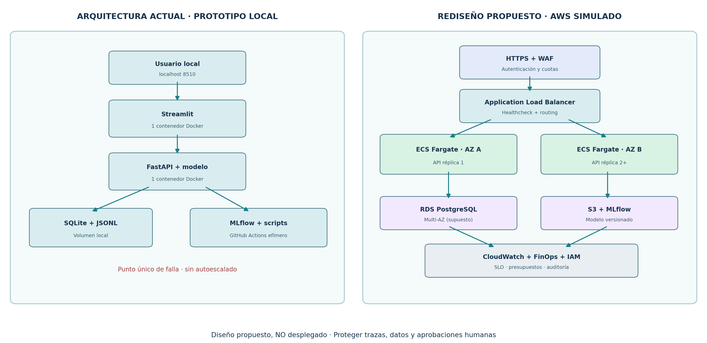
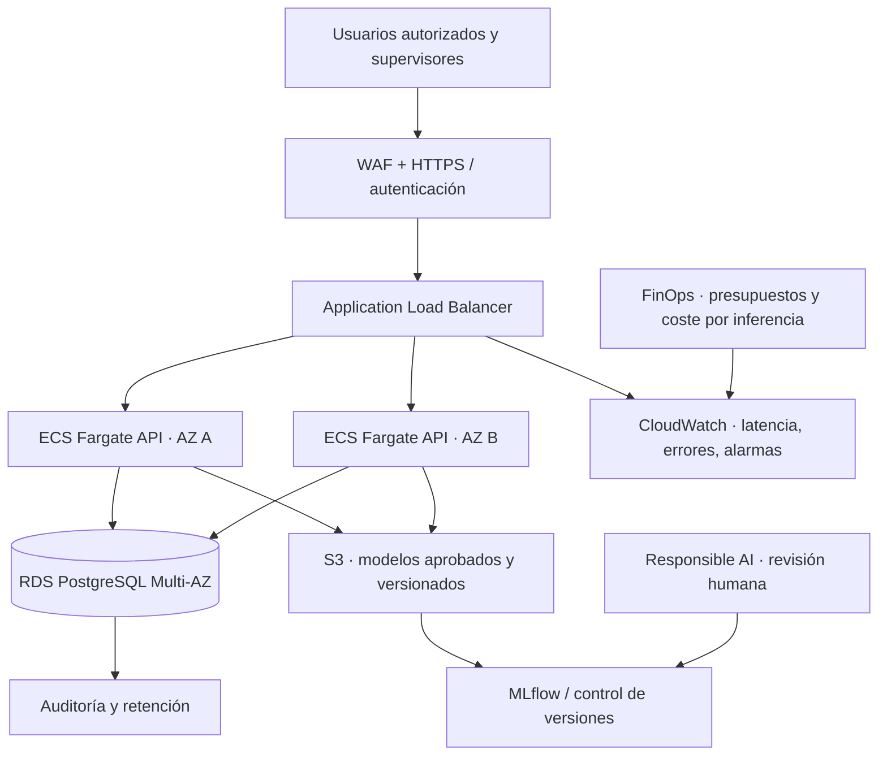

# 🏭 Predictive Maintenance AI · Actividad 9
## Rediseño de escalabilidad, FinOps y gobernanza responsable

[](https://github.com/isaaccg88/PredictiveMaintenance-AI-FaseII/actions/workflows/actividad9.yml)

**Universidad Tecmilenio · Gestión de Proyectos de Inteligencia Artificial · Módulo 3 / Semana 11**

> **Naturaleza del caso:** sistema y datos sintéticos. La arquitectura cloud AWS es una **propuesta simulada**, no un despliegue con cargos reales. Los benchmarks ejecutan FastAPI en el runner Linux de GitHub Actions, no en AWS. Las tarifas verificadas y todos los supuestos se desglosan y versionan.

## Índice
1. [Resumen ejecutivo](#1-resumen-ejecutivo)
2. [Arquitectura actual y cuellos de botella](#2-arquitectura-actual-y-cuellos-de-botella)
3. [Escalabilidad vertical y horizontal](#3-escalabilidad-vertical-y-horizontal)
4. [Arquitectura AWS propuesta](#4-arquitectura-aws-propuesta)
5. [Métricas de carga, SLA y recursos](#5-métricas-de-carga-sla-y-recursos)
6. [Optimización FinOps y costos](#6-optimización-finops-y-costos)
7. [Auditoría ética, técnica y legal](#7-auditoría-ética-técnica-y-legal)
8. [Fairness operacional entre tipos de máquina](#8-fairness-operacional-entre-tipos-de-máquina)
9. [Plan de escalamiento responsable](#9-plan-de-escalamiento-responsable)
10. [Entregables, reproducibilidad y rúbrica](#10-entregables-reproducibilidad-y-rúbrica)
11. [Referencias verificables](#11-referencias-verificables)

---

## 1. Resumen ejecutivo

La [Actividad 8](https://github.com/isaaccg88/PredictiveMaintenance-AI-FaseII/tree/actividad8-v2-observabilidad) implementó un servicio FastAPI para un modelo Random Forest que predice fallas en las próximas **72 horas**, un dashboard Streamlit, SQLite, MLflow y dos incidentes verificables. El piloto sintético tiene precision **72.38%**, recall **78.28%**, ROC-AUC **0.9655** y recall por evento **31/35 (88.57%)**, sobre **12 máquinas no vistas**. Son resultados del **generador V2 sintético**, no rendimiento industrial validado.

La Actividad 9 evalúa cómo evolucionar esta arquitectura hacia un servicio con alta disponibilidad y escalado controlado, relacionando latencia/throughput y costo unitario, sin ignorar riesgos de sesgo, transparencia, seguridad y cumplimiento.

**Decisión estratégica:** diseñar AWS como caso cloud simulado (ECS Fargate, ALB, RDS Multi-AZ, S3, IAM y observabilidad), probar carga HTTP local real, construir un modelo FinOps paramétrico y auditar calidad por subgrupos de máquinas.

## 2. Arquitectura actual y cuellos de botella

| Capa | Implementación comprobada | Límite de escala |
|---|---|---|
| Inferencia | FastAPI + Random Forest en contenedor único | Sin balanceador ni réplicas por AZ |
| Interfaz | Streamlit en contenedor único | Sin autenticación y redundancia cloud |
| Datos | SQLite en volumen Docker | Concurrencia/escalado horizontal limitado |
| Observabilidad | SQL, JSONL, métricas HTTP y trazas correlacionadas | Sin backend centralizado de trazas/alarma persistente |
| MLOps | MLflow en CI, pruebas de GitHub Actions | Experimentos temporales, sin registro/etapas cloud permanente |
| Seguridad | Puertos vinculados a loopback de Windows | Requiere IAM, TLS, gestión de secretos, segmentación, gobierno de datos |

**Escenario real conocido:** Docker local y pruebas del runner; **no** AWS, Azure o GCP ya desplegados.



*Figura 1. Arquitectura esquemática generada desde código; la parte AWS es una propuesta de diseño, no infraestructura ejecutada.*

## 3. Escalabilidad vertical y horizontal

**Vertical:** aumentar vCPU y memoria de una misma réplica puede reducir contención, a cambio de mayor costo por tarea y límite de capacidad. En esta actividad **no se considera validado** hasta hacer pruebas con límites de CPU y RAM realmente impuestos.

**Horizontal:** pasar de un endpoint HTTP a dos procesos separados y distribuir solicitudes alternativamente permite evaluar una aproximación inicial del reparto de carga. Pero comparten el mismo runner y no son un balanceador ALB real; por ello los resultados NO prueban disponibilidad multizona o capacidad de ECS.

Antes de desplegar, desacoplar persistencia SQLite hacia RDS/PostgreSQL, externalizar modelos en S3, garantizar idempotencia y aislar procesos de dashboard/inferencia. Definir configuración consistente, sesiones sin estado, healthchecks y límites de autoscaling.

## 4. Arquitectura AWS propuesta

**Referencia AWS us-east-1** por sus tarifas públicas comparables. La elección de región y residencia de datos de una empresa mexicana requeriría revisión legal, latencia y seguridad antes de contratar.



El **despliegue a AWS está propuesto, no ejecutado**. El costo financiero del modelo no debe asumirse suficiente para certificar arquitectura segura o resiliente.

## 5. Métricas de carga, SLA y recursos

El [benchmark reproducible](actividad9/benchmark.py) ejecuta POST /predict con concurrencia 1/4/8/16 frente a una y dos instancias de la API, registrando throughput, p50/p95/p99, porcentaje de éxito, duración y huella de procesos en el runner.

**Objetivos propuestos para un piloto cloud:** disponibilidad ≥99%, respuestas oportunas 2xx ≤500 ms en ≥99% de peticiones y revisión de p95 ≤500 ms. Son **metas**, no SLA contractual observado en AWS.

- [Resultado crudo de benchmarking](actividad9/evidence/load_benchmark.json)
- [Script de carga](actividad9/benchmark.py)
- [Evidencia de la ejecución de CI](https://github.com/isaaccg88/PredictiveMaintenance-AI-FaseII/actions/workflows/actividad9.yml)

La capacidad disponible por tarea no debe extrapolarse directamente del runner a instancias ARM de Fargate; el informe conserva esta limitación. La rama propuesta incluye comparaciones de respuesta de una vs dos instancias, pero **no prueba escalado vertical de contenedores**.

## 6. Optimización FinOps y costos

El [modelo económico reproducible](actividad9/finops.py) estudia tres arquitecturas y tres volúmenes de solicitudes; genera [costos comparados en CSV](actividad9/evidence/cost_comparison.csv) y un [JSON con tarifas, supuestos y fórmulas](actividad9/evidence/finops_model.json).

| Arquitectura | Escalado | Base de datos | Alcance |
|---|---|---|---|
| cloud_naive | 1 API x86, sin redundancia | Single-AZ supuesto | Referencia de migración mínima, no HA |
| ha_without_rightsizing | 2+ API x86, redundancia | Multi-AZ supuesto | Referencia alta disponibilidad |
| proposed_rightsized_arm | 2+ API ARM dimensionadas, redundancia | Multi-AZ supuesto | Optimización de tarifas por validar en ARM |

**Principio esencial:** comparar ahorro entre opciones con **igual resiliencia**. No sería correcto proclamar ahorro comparando arquitectura sin redundancia frente a arquitectura con HA. El costo mensual se descompone por tareas Fargate, ALB, RDS, CloudWatch, almacenamiento S3 y egreso.

**Tarifas públicas de referencia en us-east-1:** Linux/x86 Fargate USD **0.04048/vCPU-h** y **0.004445/GB-h**; ARM USD **0.03238/vCPU-h** y **0.00356/GB-h**; ALB USD **0.0225/h** + **0.008/LCU-h** según dimensiones de carga. El supuesto de una LCU/h es aproximado.

**Importes NO verificados como cotización:** RDS Single-AZ USD 45/mes, Multi-AZ USD 95/mes, logs USD 0.50/GB, egreso USD 0.09/GB, almacenamiento USD 0.023/GB-mes. Son variables de simulación. **NAT, WAF, backups, soporte y costo humano se excluyen** de totales; deberán presupuestarse antes de aprobar el despliegue. No proyectar ROI financiero con estos importes sin validación completa.

### Marco FinOps

Aplicamos las fases [Inform → Optimize → Operate](https://www.finops.org/framework/phases/): asignación y trazabilidad de costos, dimensionamiento adecuado/arquitecturas equivalentes, presupuesto mensual, alertas de gasto y evaluación periódica de USD por 1,000 inferencias válidas manteniendo SLO.

## 7. Auditoría ética, técnica y legal

| Dimensión | Riesgo | Control propuesto | Evidencia |
|---|---|---|---|
| Ética | Falsas alertas generan mantenimiento innecesario | Supervisión humana y medición de precisión/recall | Matriz de confusión y análisis por máquinas |
| Fairness operacional | Recall y falsa alarma diferentes en A/B/C | TPR/FPR por tipo, revisión de brechas | [fairness por tipo](actividad9/evidence/fairness_machine_types.json) |
| Seguridad | Trazas y datos accesibles sin permisos mínimos | IAM, autenticación, TLS, KMS, mínimos privilegios | Propuesta de arquitectura |
| MLOps | Actualizar un modelo sin controlar degradación | MLflow, registro aprobado, canary y rollback supervisado | A8 GitHub Actions |
| Operación | Caída de AZ, escalado insuficiente | Dos AZ, ALB, healthchecks, recuperación probada | Propuesta (no probada en AWS) |
| Legal (condicional) | Uso futuro de nombres, turnos o información de trabajadores | Minimización, aviso de privacidad, retención y evaluación jurídica | Matriz normativa |

**NIST AI RMF 1.0:** GOVERN, MAP, MEASURE y MANAGE ofrecen una estructura de gobierno, análisis de riesgos, evaluación y controles. **ISO/IEC 42001:2023** es referencia de sistema de gestión de IA, no certificación conseguida.

**México:** la Ley Federal de Protección de Datos Personales en Posesión de los Particulares, publicada en marzo de 2025 y reformada en noviembre de 2025, debe evaluarse si el caso evoluciona a uso de datos personales. **En el piloto sintético actual no se procesan datos personales de operadores**. La revisión legal es orientativa, no dictamen jurídico de conformidad.

## 8. Fairness operacional entre tipos de máquina

El script [fairness.py](actividad9/fairness.py) reconstruye el dataset V2, conserva las **12 máquinas piloto excluidas del entrenamiento** y desglosa precision, recall/TPR, FPR, ROC-AUC y soporte entre los tipos A/B/C.

- Se propone revisar brechas de igualdad de oportunidad (**TPR máxima − mínima >0.10**).
- Se informa la muestra disponible y se evita dar por concluida la equidad basándose en solo cuatro máquinas por tipo.
- Las diferencias por grupo son **fairness técnica**, no fairness en categorías protegidas de personas.

[Resultados por grupo (JSON)](actividad9/evidence/fairness_machine_types.json) · [Resumen académico](actividad9/evidence/fairness_summary.md)

## 9. Plan de escalamiento responsable

| Fase | Control y responsable | Condición para avanzar |
|---|---|---|
| 0. Auditoría del piloto | ML Lead / SRE: baseline, costo por inferencia y gaps A/B/C | Evidencia reproducible |
| 1. Seguridad | Security/Legal: inventario, IAM, cifrado, retención | Riesgos críticos mitigados |
| 2. Cloud staging | SRE/FinOps: entorno de pruebas dos AZ y presupuesto aprobado | SLA y recuperación demostrados realmente |
| 3. Escalado gradual | Operaciones: autoscaling, canary y rollback supervisado | p95, éxito, costo y gobernanza aprobados |
| 4. Operación | FinOps semanal, ML trimestral, incidentes y auditorías | SLA estable, métricas accesibles, sin sesgos inadmisibles |

No se habilitará mantenimiento físico automático; las decisiones siguen siendo humanas. El análisis de sostenibilidad incluye menor consumo de recursos por solicitud y visibilidad de costo, pero no inventa emisiones de CO2 sin métricas de proveedor.

## 10. Entregables, reproducibilidad y rúbrica

La plataforma solicita **un ZIP** con **(1) reporte técnico Word/PDF, (2) anexo técnico XLS/PDF y (3) diagrama de arquitectura imagen/PDF**. No asumimos que la autorización verbal de entrega GitHub de la Actividad 8 sustituya automáticamente el requisito escrito de la Actividad 9.

El [workflow Actividad 9](.github/workflows/actividad9.yml) construye y verifica automáticamente, y publica un paquete ZIP descargable como artefacto de GitHub Actions:

| Criterio (25 pts) | Evidencia principal |
|---|---|
| Análisis y rediseño escalabilidad | Diagrama fuente y PNG/PDF, benchmarks 1 y 2 endpoints, diseño AWS |
| Optimización FinOps | Modelo tarifario, 9 escenarios, costo unitario, supuestos y SLA |
| Gobernanza ética/legal | Auditoría NIST/ISO/LFPDPPP y fairness A/B/C |
| Plan responsable | Hoja de ruta, responsables, puertas de aprobación y riesgos |

**Archivos esperados al terminar el workflow:** [reporte PDF](actividad9/entregables/01_reporte_tecnico_actividad9.pdf), [anexo PDF](actividad9/entregables/02_anexo_tecnico_actividad9.pdf), [diagrama PNG](actividad9/entregables/03_arquitectura_actual_vs_propuesta.png) y [ZIP de entrega](actividad9/entregables/Actividad9_Entregables_Tecmilenio.zip).

### Reproducibilidad

```bash
python -m actividad8.train_v2
# Iniciar dos servidores FastAPI en puertos 8008 y 8009, con directorios de estado separados
python -m actividad9.benchmark --single http://127.0.0.1:8008 --second http://127.0.0.1:8009
python -m actividad9.fairness
python -m actividad9.finops
python -m actividad9.entregables
pytest -q actividad9/test_activity9.py
```

En CI se ejecuta esa secuencia en Linux. No requiere credenciales ni cuenta AWS.

## 11. Referencias verificables

- [AWS Fargate pricing](https://aws.amazon.com/fargate/pricing/)
- [AWS ELB/ALB pricing](https://aws.amazon.com/elasticloadbalancing/pricing/)
- [AWS RDS PostgreSQL pricing](https://aws.amazon.com/rds/postgresql/pricing/)
- [FinOps Foundation — Inform, Optimize, Operate](https://www.finops.org/framework/phases/)
- [AWS Well-Architected Framework](https://docs.aws.amazon.com/wellarchitected/latest/framework/the-pillars-of-the-framework.html)
- [NIST AI Risk Management Framework](https://airc.nist.gov/airmf-resources/airmf/5-sec-core/)
- [ISO/IEC 42001:2023](https://www.iso.org/standard/42001)
- [LFPDPPP México, texto vigente en Cámara de Diputados](https://www.diputados.gob.mx/LeyesBiblio/pdf/LFPDPPP.pdf)

**Nota metodológica:** la documentación y archivos de costos son de simulación parametrizada. Antes de despliegue real, confirmar tarifas en AWS Pricing Calculator, arquitectura y residencia de datos, pruebas en Fargate con límites reales y procedimientos de aprobación humana.
