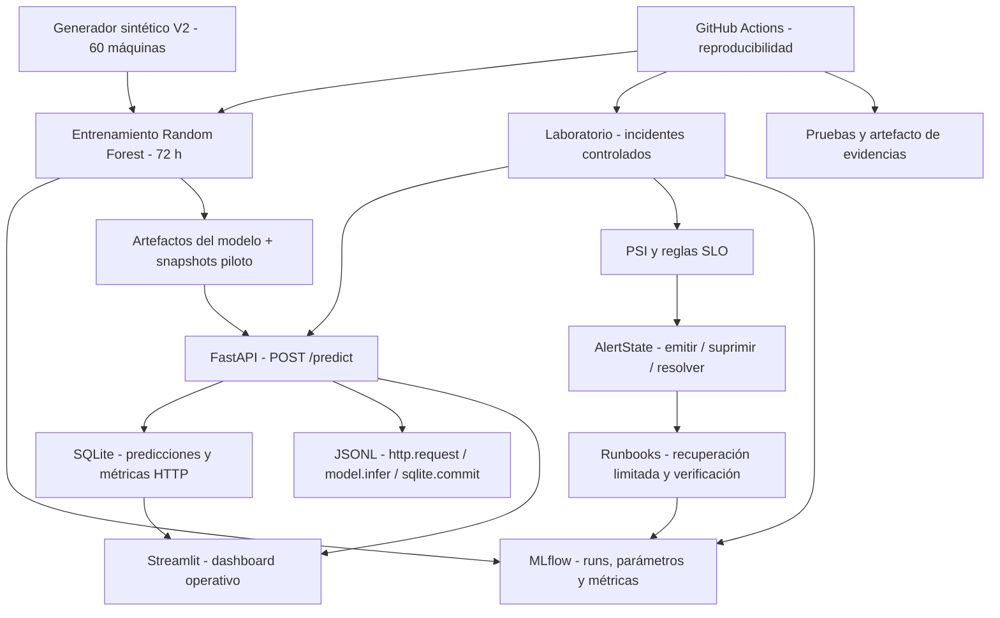
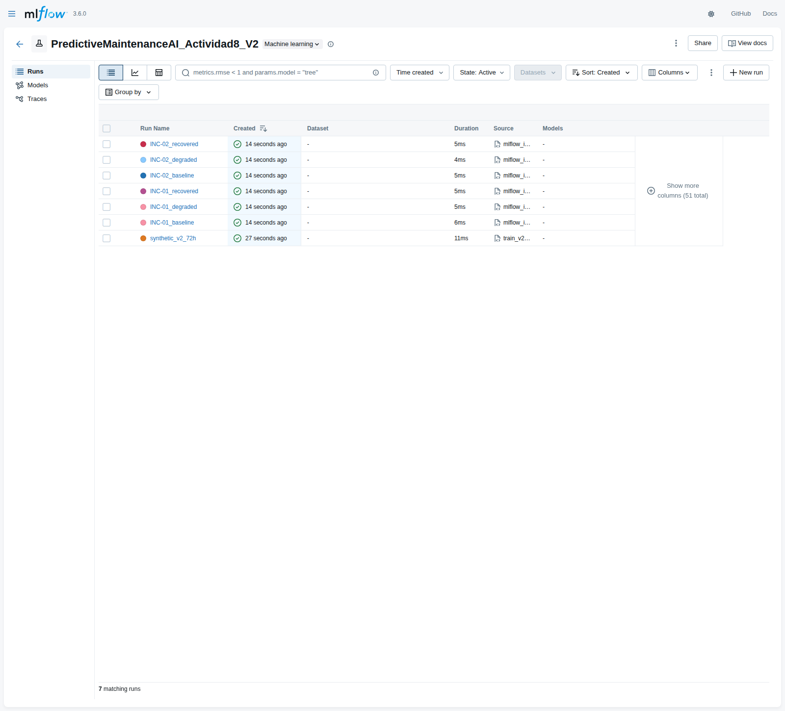
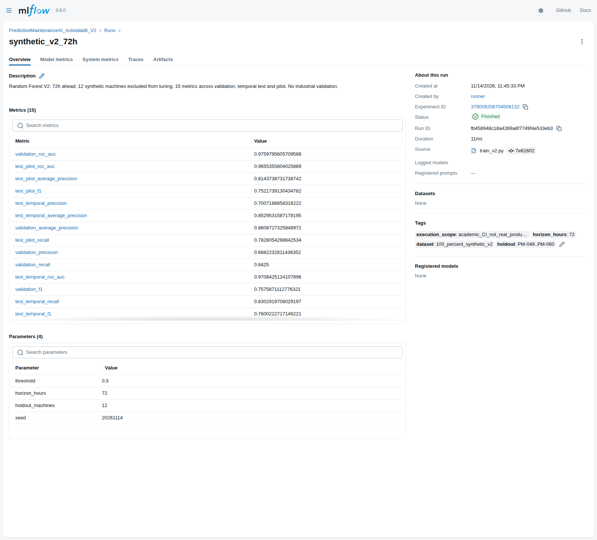
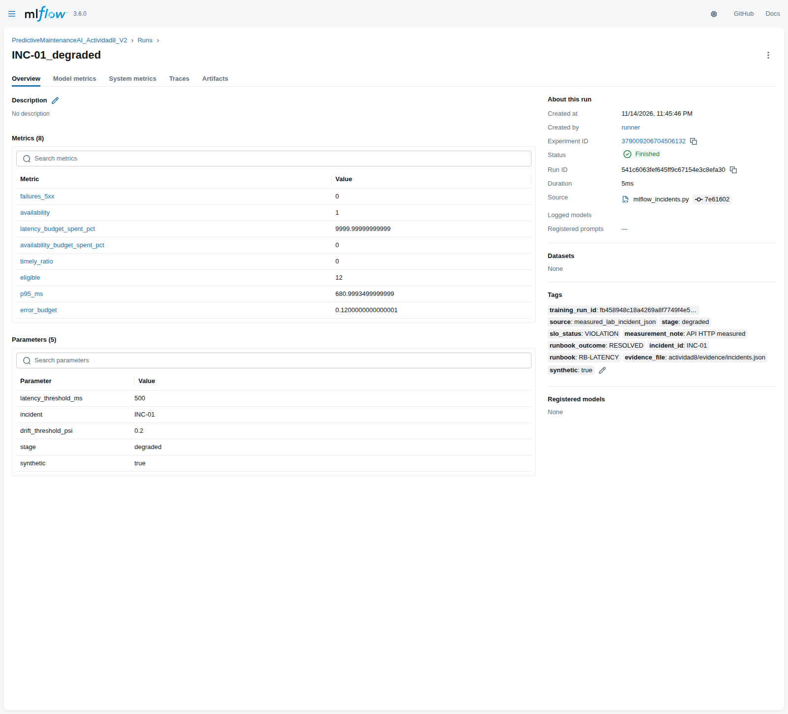
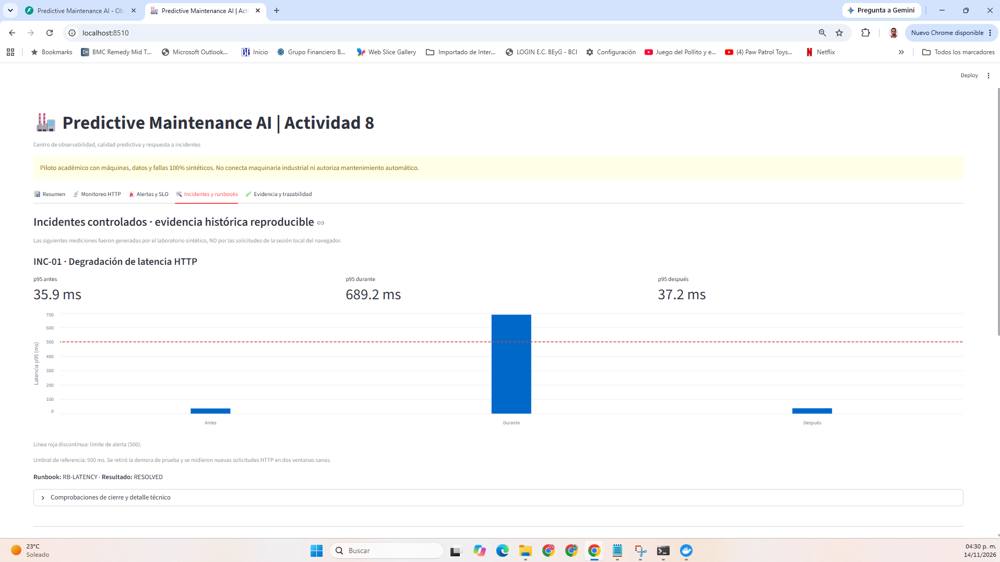
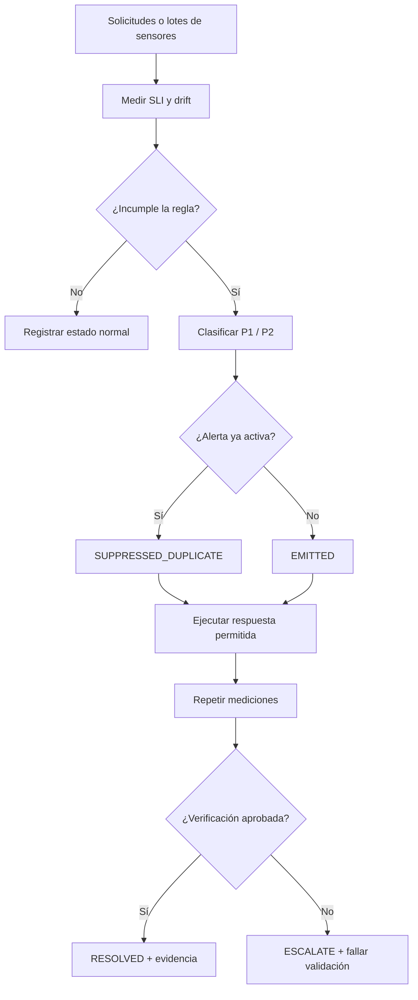

# 🏭 Predictive Maintenance AI · Actividad 8
### Monitorización proactiva, observabilidad, MLOps y gobernanza operativa

**Universidad Tecmilenio · Gestión de Proyectos de Inteligencia Artificial · Módulo 3 / Semana 10**  
**Caso académico:** servicio de mantenimiento predictivo, horizonte de falla a 72 horas.  
**Herramientas:** Python · scikit-learn · MLflow 3.6 · FastAPI · SQLite · Streamlit · Docker · GitHub Actions.  
**Rama de entrega:** actividad8-v2-observabilidad. [Repositorio de la actividad](https://github.com/isaaccg88/PredictiveMaintenance-AI-FaseII/tree/actividad8-v2-observabilidad) · [Ejecutar auditoría en CI](https://github.com/isaaccg88/PredictiveMaintenance-AI-FaseII/actions/workflows/actividad8.yml).

> **Alcance del experimento.** La empresa, las 60 máquinas, los sensores, los eventos y las predicciones son **100% sintéticos**. Los incidentes se inyectan deliberadamente. Las solicitudes HTTP del laboratorio sí se miden contra FastAPI; no hay monitorización industrial 24/7 ni control automático de maquinaria. Las decisiones de mantenimiento y de promoción de modelos requieren supervisión humana.

---

## Índice

1. [Resumen ejecutivo y resultados](#1-resumen-ejecutivo-y-resultados)
2. [Arquitectura de observabilidad y MLOps](#2-arquitectura-de-observabilidad-y-mlops)
3. [Dataset V2, modelo y validación](#3-dataset-v2-modelo-y-validación)
4. [Diseño de monitoreo: métricas, logs y trazas](#4-diseño-de-monitoreo-métricas-logs-y-trazas)
5. [MLflow: experimentos, escenarios y evidencias](#5-mlflow-experimentos-escenarios-y-evidencias)
6. [SLO, error budget y alertas inteligentes](#6-slo-error-budget-y-alertas-inteligentes)
7. [Dashboard operativo](#7-dashboard-operativo)
8. [Incidente 1: degradación de latencia](#8-incidente-1-degradación-de-latencia)
9. [Incidente 2: detección de data-drift](#9-incidente-2-detección-de-data-drift)
10. [Runbooks, automatización y gobernanza](#10-runbooks-automatización-y-gobernanza)
11. [GitHub Actions, pruebas y reproducibilidad](#11-github-actions-pruebas-y-reproducibilidad)
12. [Conclusiones, limitaciones y futuras mejoras](#12-conclusiones-limitaciones-y-futuras-mejoras)
13. [Cobertura de los cuatro entregables](#13-cobertura-de-los-cuatro-entregables)

---

## 1. Resumen ejecutivo y resultados

### Problema de negocio

Las fallas no planificadas de maquinaria generan paros, correcciones urgentes y pérdida de productividad. Un modelo que predice riesgo de falla a 72 horas puede apoyar decisiones anticipadas, pero **el modelo por sí solo no garantiza continuidad operativa**: también es necesario conocer la disponibilidad de la API, detectar latencia, controlar cambios en sensores, registrar incidentes y verificar si las respuestas funcionaron.

### Objetivo de la Actividad 8

Implementar un laboratorio reproducible de observabilidad con métricas, logs y trazas, seguimiento con MLflow, SLO y presupuestos de error, al menos cinco alertas, dos incidentes críticos y runbooks con evidencia antes/durante/después.

### Resultados demostrados

| Componente | Resultado medido o implementado | Evidencia |
|---|---|---|
| Modelo V2 | **72.38% precision; 78.28% recall; ROC-AUC 0.9655** en piloto sintético | [evaluación V2](actividad8/results/evaluation_v2.json) |
| Horizonte y piloto | **72 h**, 12 máquinas excluidas del entrenamiento | [metodología](actividad8/docs/METODOLOGIA.md) |
| Observabilidad | HTTP medido, eventos JSONL, trazas correlacionadas y registros SQLite | [API](actividad8/service.py) · [traza preservada](actividad8/evidence/ejemplo_traza_real.json) |
| Seguimiento MLflow | 1 run de entrenamiento con 15 métricas + **6 runs de etapas de incidentes** | [registro de experimentos](actividad8/mlflow_incidents.py) · [auditoría automática](actividad8/mlflow_incident_audit.py) |
| Alertamiento | **6 reglas**, dos incidentes activados, deduplicación demostrada | [reglas](actividad8/rules.py) · [incidentes](actividad8/evidence/incidents.json) |
| INC-01 | Latencia p95 **35.9 → 689.2 → 37.2 ms** (límite 500 ms) | [captura](actividad8/evidence/screenshots/INC-01_latencia_antes_durante_despues.png) |
| INC-02 | PSI **0.071 → 10.361 → 0.056** (límite 0.20) | [captura](actividad8/evidence/screenshots/INC-02_drift_antes_durante_despues.png) |
| Automatización | Dos runbooks con comprobación de cierre; ejecución en GitHub Actions | [workflow](.github/workflows/actividad8.yml) · [ejecuciones](https://github.com/isaaccg88/PredictiveMaintenance-AI-FaseII/actions/workflows/actividad8.yml) |

**Interpretación:** los resultados del servicio y de los incidentes son medibles y reproducibles en el laboratorio. No prueban desempeño industrial ni una instalación cloud permanente.

---

## 2. Arquitectura de observabilidad y MLOps



**Componentes y responsabilidad técnica**

| Componente | Función | Restricción |
|---|---|---|
| [Simulador V2](actividad8/simulator.py) | Sensores, fallas y etiquetas futuras | Mecanismos y relaciones artificiales |
| [Entrenamiento](actividad8/train_v2.py) | Random Forest y evaluación sin ajustar en el piloto | Métricas no generalizables a maquinaria real |
| [FastAPI](actividad8/service.py) | Inferencia, instrumentación HTTP y trazabilidad | Servicio local de demostración |
| SQLite / JSONL | Persiste inferencias, tiempos y eventos correlacionados | No sustituye un sistema centralizado de telemetría |
| [MLflow](actividad8/mlflow_incidents.py) | Registra entrenamiento y escenarios del laboratorio | Tracking store efímero dentro de CI |
| [Streamlit](actividad8/dashboard.py) | Panel interactivo de resultados y SLO | Combina métricas locales e histórico del laboratorio, identificados por separado |
| [GitHub Actions](.github/workflows/actividad8.yml) | Entrena, comprueba, inyecta incidentes y conserva evidencias | El runner se destruye al terminar |

Las «trazas» implementadas son **eventos correlacionados por trace_id**; no afirmamos utilizar tracing distribuido OpenTelemetry. Toda automatización de corrección se limita al laboratorio.

---

## 3. Dataset V2, modelo y validación

El generador V2 produce **129,600 observaciones sintéticas** de 60 máquinas, con lecturas cada 6 horas. Se simulan **853 eventos de falla** en la ejecución de referencia, incluyendo desgaste, deterioro térmico, vibración y fallas menos previsibles. Se agregan señales precursoras imperfectas y falsas anomalías.

- **Etiqueta:** falla entre las próximas 6 y 72 horas; se censuran las últimas 12 observaciones sin horizonte futuro completo.
- **Variables:** temperatura, vibración, presión, RPM, torque, índice de desgaste, carga, horas desde servicio, tendencias y tipo de equipo.
- **Separación:** 48 máquinas para ajuste y pruebas temporales; PM-049 a PM-060 se reservan como piloto no visto durante el ajuste.
- **Modelo:** Random Forest con 130 árboles, profundidad máxima 12 y pesos balanceados. Imputación y codificación ajustadas exclusivamente sobre entrenamiento.
- **Umbral:** 0.50, seleccionado en validación bajo criterio F2 y requisito mínimo de precision; no se optimizó contra el conjunto piloto.

### Evaluación comparada de la V2

| Métrica | Validación | Prueba temporal | Piloto no visto |
|---|---:|---:|---:|
| Precision | 68.82% | 70.07% | **72.38%** |
| Recall | 84.25% | 83.03% | **78.28%** |
| F1 | 0.7576 | 0.7600 | **0.7522** |
| ROC-AUC | 0.9760 | 0.9708 | **0.9655** |
| Average Precision | 0.8609 | 0.8530 | **0.8144** |

**Matriz de confusión del piloto (4,896 ventanas):** 346 verdaderos positivos, 132 falsos positivos, 96 falsos negativos y 4,322 verdaderos negativos. El recall por evento fue **31 de 35 fallas (88.57%)**. Hay aproximadamente **0.75 falsas ventanas por máquina-semana**; ese valor no equivale a episodios de alerta ya deduplicados.

**Advertencia de comparabilidad:** V1 obtuvo 16.36% de precision y 0.8621 ROC-AUC sobre **otro generador sintético**. La aparente mejora de V2 se debe en parte a que el escenario nuevo contiene relaciones generativas más predictivas. No constituye prueba controlada de que el algoritmo haya mejorado sobre un mismo conjunto. Véase [metodología completa](actividad8/docs/METODOLOGIA.md).

---

## 4. Diseño de monitoreo: métricas, logs y trazas

### Diccionario de indicadores

| Indicador | Cálculo / origen | Objetivo de decisión |
|---|---|---|
| Disponibilidad HTTP | 1 − (solicitudes HTTP 5xx / solicitudes elegibles) | Detectar servicio no disponible; SLO ≥99% |
| Oportunidad | Respuestas 2xx en ≤500 ms / solicitudes elegibles | Detectar degradación percibida por usuario; SLO ≥99% |
| Latencia p95 | Percentil 95 de duración medida de POST /predict | Diagnóstico de cola larga y validación de recuperación |
| Errores 5xx | Conteo y tasa sobre ventana de peticiones | Priorizar incidentes P1 |
| Uso de CPU | Muestreo con psutil en laboratorio | Regla de capacidad; **CPU del runner**, no del contenedor |
| Calidad supervisada | Precision, recall, F1, ROC-AUC, AP | Evaluación **offline** cuando existen etiquetas maduras |
| Drift | Population Stability Index (PSI) de temperatura | Detectar lotes con distribución alterada |
| Alertas deduplicadas | EMITTED / SUPPRESSED_DUPLICATE / RESOLVED | Minimizar ruido y evitar escalaciones redundantes |

### Logs estructurados de una solicitud auténtica del laboratorio

En la ejecución reproducible [#43650203109](https://github.com/isaaccg88/PredictiveMaintenance-AI-FaseII/actions/runs/43650203109) se registraron eventos correlacionados por el mismo identificador:

```text
trace_id = 856a1598-2420-40a1-8b9a-070c179cbc8a
model.infer   duration_ms = 26.576
sqlite.commit record_id   = 1
http.request  status      = 200, duration_ms = 28.846
```

Los valores provienen de [una muestra JSON preservada y trazable](actividad8/evidence/ejemplo_traza_real.json). La diferencia entre el tiempo de inferencia y el HTTP incluye la instrumentación, la serialización y el trabajo adicional de la solicitud. No es un ejemplo inventado.

**Mecanismo de trazabilidad:** FastAPI genera un UUID por solicitud; ese mismo trace_id se incluye en los registros de inferencia, persistencia y respuesta HTTP, además de guardarse en SQLite. Permite investigar una predicción concreta desde el dashboard hasta sus operaciones internas. Véanse [service.py](actividad8/service.py) y [GET /history](actividad8/service.py).

### Qué muestran los dashboards

El panel reúne métricas de calidad offline con el estado vivo de la API local. La separación es explícita: la latencia HTTP procede de solicitudes reales al contenedor; las cifras de incidentes proceden del laboratorio de GitHub Actions o de una corrida previa registrada en JSON.

---

## 5. MLflow: experimentos, escenarios y evidencias

### Seguimiento de modelos y experimentos

Se utiliza **MLflow 3.6** como herramienta de seguimiento real. El experimento se llama **PredictiveMaintenanceAI_Actividad8_V2**. El entrenamiento registra 4 parámetros (semilla, horizonte, tamaño del piloto y umbral), **15 métricas** (cinco para cada uno de tres subconjuntos), los archivos de evaluación/metadata y el **modelo Random Forest serializado** como artefacto de MLflow.

Además, para acercar la demostración al ejemplo del profesor, se incorporó [mlflow_incidents.py](actividad8/mlflow_incidents.py), que registra **seis runs independientes de los incidentes**:

| Run MLflow | Qué registra | Evidencia original |
|---|---|---|
| INC-01_baseline | Latencia, disponibilidad y oportunidad antes de la falla | [incidents.json](actividad8/evidence/incidents.json) |
| INC-01_degraded | Tiempo HTTP y consumo del presupuesto durante la falla | [incidents.json](actividad8/evidence/incidents.json) |
| INC-01_recovered | Nuevas peticiones y recuperación verificada | [incidents.json](actividad8/evidence/incidents.json) |
| INC-02_baseline | PSI de sensores normales | [incidents.json](actividad8/evidence/incidents.json) |
| INC-02_degraded | PSI del lote de temperatura alterado | [incidents.json](actividad8/evidence/incidents.json) |
| INC-02_recovered | PSI tras retirar el lote sintético irregular | [incidents.json](actividad8/evidence/incidents.json) |

**No son seis reentrenamientos:** cada run registra una fase medida de los dos escenarios, asociada al mismo experimento y al run de entrenamiento. [mlflow_incident_audit.py](actividad8/mlflow_incident_audit.py) lee los valores del tracking store con MlflowClient y comprueba que coincidan con incidents.json. La verificación genera [artefactos descargables de CI](https://github.com/isaaccg88/PredictiveMaintenance-AI-FaseII/actions/workflows/actividad8.yml). No se inventan valores para completar capturas.

### Métricas de MLflow verificadas del modelo

| Subconjunto | Precision | Recall | ROC-AUC |
|---|---:|---:|---:|
| Validación | 0.688223 | 0.842500 | 0.975980 |
| Prueba temporal | 0.700719 | 0.830292 | 0.970843 |
| Piloto | 0.723849 | 0.782805 | 0.965536 |

### Capturas auténticas de la interfaz MLflow

Las siguientes imágenes se capturaron con **Chromium sobre MLflow 3.6.0 en GitHub Actions**, leyendo los runs realmente registrados por el laboratorio. No son recreaciones ni gráficas dibujadas para aparentar una interfaz.



**Figura 3 — Listado de experimentos:** se observan siete runs: uno de entrenamiento y seis correspondientes a antes/durante/después de INC-01 e INC-02. Cada etapa tiene su propia identidad de ejecución.



**Figura 4 — Run del modelo V2:** muestra las 15 métricas y los parámetros del experimento; la precisión del piloto (0.723849) coincide con el reporte JSON evaluado automáticamente.



**Figura 5 — Run INC-01_degraded:** expone latencia p95 medida, SLO, presupuesto y etiquetas de incidente, severidad operativa, runbook y naturaleza sintética. Es una evidencia adicional al gráfico antes/durante/después mostrado en la sección 8.

Para inspeccionar las imágenes a tamaño completo: [runs](actividad8/evidence/screenshots/MLflow_experimento_runs.png) · [modelo V2](actividad8/evidence/screenshots/MLflow_modelo_v2_metricas.png) · [latencia](actividad8/evidence/screenshots/MLflow_incidente_latencia.png).

La captura se realiza mediante el [script reproducible](actividad8/mlflow_capture.py) y el [workflow independiente](.github/workflows/actividad8-mlflow-screenshots.yml). Ver también [evidencia técnica MLflow](actividad8/docs/MLFLOW_EVIDENCIA.md).

**Alcance:** MLflow es un tracking store del laboratorio y no una plataforma de monitoreo permanente. La calidad predictiva de un modelo en producción solo podrá calcularse cuando se conozcan las fallas reales y maduren las etiquetas.

---

## 6. SLO, error budget y alertas inteligentes

### SLI, SLO y presupuestos de error

Se definen objetivos de demostración de 99% de disponibilidad y 99% de oportunidad (respuesta satisfactoria en ≤500 ms). Para una ventana de 12 solicitudes, el presupuesto de errores es:

```text
Presupuesto = N * (1 - SLO)
            = 12 * (1 - 0.99)
            = 0.12 solicitudes equivalentes
```

Por tanto, **una sola solicitud no oportuna supera el presupuesto completo** en una ventana tan pequeña. Esto demuestra el principio didáctico de error budget, no un presupuesto industrial con ventana mensual o burn-rate calibrado.

### Seis reglas ejecutables

| Regla | Severidad | Condición | Runbook |
|---|---|---|---|
| Disponibilidad | **P1** | Disponible / elegible <99% | RB-AVAIL |
| Errores 5xx | **P1** | Errores HTTP 5xx >1% | RB-AVAIL |
| Latencia | P2 | Solicitudes oportunas / elegibles <99% | RB-LATENCY |
| CPU | P2 | Medición >85% | RB-CAPACITY |
| Data drift | P2 | PSI >0.20 con muestra ≥100 | RB-DRIFT |
| Calidad supervisada | P2 | AUC <0.75 con etiquetas maduras | RB-QUALITY |

**Prioridad:** P1 indica afectación crítica de disponibilidad o errores del servicio. P2 corresponde a degradación de tiempos, capacidad, distribución o calidad. Los seis predicados se verifican con pruebas, pero **solo latencia y drift se provocan como incidentes completos** en la actividad.

### Control de ruido de alertas

El motor [AlertState](actividad8/rules.py) muestra la transición:

```text
DETECTADA → EMITTED
REPETIDA  → SUPPRESSED_DUPLICATE
RECUPERADA → RESOLVED
```

El resultado del laboratorio de referencia fue **2 alertas emitidas, 1 duplicada suprimida y 2 resoluciones**. Esto evita multiplicar notificaciones de una misma falla mientras permanece activa. No existe aún un motor de alertas centralizado o un equipo on-call real.

---

## 7. Dashboard operativo

El dashboard de Streamlit se ejecuta en **http://localhost:8510** y tiene cinco pestañas:

| Vista | Contenido demostrable | Cómo interpretarla |
|---|---|---|
| Resumen | Precision, recall, ROC-AUC, estado de FastAPI y botón de predicción de 72 h | Combina calidad **offline** con mediciones locales identificadas |
| Monitoreo HTTP | Serie temporal de duraciones, status 200/5xx y trace_id | Valores vivos del contenedor al enviar POST /predict |
| Alertas y SLO | Seis reglas, severidades, presupuestos e historial de alertas | Historial del laboratorio; no monitoreo 24/7 |
| Incidentes y runbooks | Comparaciones Antes → Durante → Después, umbrales y comprobaciones | Dos simulaciones sintéticas verificadas |
| Evidencia y trazabilidad | Estado de runbooks, fechas y enlaces a CI | Permite localizar código y ejecuciones |

**Prueba local registrada:** en la computadora de demostración se ejecutaron dos predicciones a 72 horas mediante Streamlit: PM-049 con riesgo de 45.7% (MEDIO), PM-050 con 0.0% (BAJO). Se comprobaron cinco registros en SQLite y una latencia p95 local aproximada de 139.8 ms. Son observaciones del piloto local, no las mismas cifras del laboratorio de GitHub Actions.

---

## 8. Incidente 1: degradación de latencia

### Objetivo, hipótesis y condición de alerta

**INC-01:** demostrar que una API que antes respondía oportunamente incumple el objetivo de 500 ms al introducir una demora controlada, y que el runbook solo registra resolución después de enviar nuevas solicitudes y comprobar dos ventanas saludables consecutivas.

**Procedimiento:** se consulta /health, se hace calentamiento de la API y se mide una ventana normal; luego se agrega una demora de 650 ms únicamente con LAB_MODE y token local. Las solicitudes se realizan a FastAPI, no a un valor fijo de latencia. La inyección se retira enviando peticiones posteriores sin encabezado de falla.

### Medición antes, durante y después

| Etapa | Latencia p95 | Umbral | Evaluación |
|---|---:|---:|---|
| Antes | **35.9 ms** | ≤500 ms | Correcto |
| Durante | **689.2 ms** | ≤500 ms | Violación del SLO |
| Después | **37.2 ms** | ≤500 ms | Recuperación comprobada |



**Figura 1.** La línea discontinua representa el límite de 500 ms. El escenario supera el umbral y después regresa a valores normales. Los tiempos exactos pueden variar en otros runners, porque dependen de peticiones HTTP reales.

### Runbook RB-LATENCY

1. Confirmar /health y el incumplimiento de disponibilidad u oportunidad.
2. Identificar por trace_id la solicitud y su tiempo medido.
3. Emitir alerta P2 y suprimir el duplicado durante el mismo incidente.
4. Retirar **solo la inyección experimental**, sin fingir reinicio ni escalado real.
5. Enviar dos ventanas de solicitudes sanas consecutivas; si alguna falla, continuar la verificación hasta el límite definido.
6. Declarar **RESOLVED** únicamente con comprobaciones verdaderas. De lo contrario, **ESCALATE** y CI falla.

**Resultado:** en el registro de referencia, RB-LATENCY terminó en RESOLVED con recuperación verificada. Véanse [evidencias JSON](actividad8/evidence/incidents.json), [código del laboratorio](actividad8/laboratory.py) y [runbooks](actividad8/docs/RUNBOOKS.md).

---

## 9. Incidente 2: detección de data-drift

### Problema y técnica estadística

**INC-02:** comprobar que un lote de sensores con distribución alterada es detectado sin esperar etiquetas futuras. Se toma una distribución histórica de temperatura como referencia y se compara con un lote sintético cuyo sensor fue desplazado aproximadamente +14 °C.

Se utiliza **Population Stability Index (PSI)**, calculado sobre intervalos de referencia:

```text
PSI = SUM_i (p_actual_i - p_referencia_i)
            * ln(p_actual_i / p_referencia_i)
```

La regla exige al menos 100 observaciones por muestra y dispara alerta cuando PSI >0.20. El PSI cuantifica diferencia de distribución; **no demuestra automáticamente que haya bajado el ROC-AUC del modelo**.

### Comparación del experimento

| Etapa | PSI de temperatura | Umbral | Evaluación |
|---|---:|---:|---|
| Antes | **0.071** | ≤0.20 | Lote estable |
| Durante | **10.361** | ≤0.20 | Drift pronunciado |
| Después | **0.056** | ≤0.20 | Lote restaurado |


**Figura 2.** La perturbación de sensores produce un PSI elevado, claramente por encima del umbral. Después de retirar el lote anómalo se restaura una distribución normal.

### Runbook RB-DRIFT

1. Verificar que las muestras cumplen el mínimo de observaciones.
2. Calcular PSI de referencia y lote alterado; emitir alerta P2 si excede 0.20.
3. **Poner en cuarentena el lote sintético**. El laboratorio registra cero inferencias operativas a partir de ese lote.
4. Restaurar una muestra previamente validada y recalcular PSI desde los nuevos datos.
5. Cerrar como **RESOLVED** solo si PSI <0.20; en otro caso escalar al responsable ML.

**Resultado:** RB-DRIFT = RESOLVED. Esta respuesta confirma la recuperación de las entradas del laboratorio; **no representa reentrenamiento ni prueba de recuperación de precision en datos futuros**.

---

## 10. Runbooks, automatización y gobernanza

### Catálogo completo de procedimientos

| Runbook | Detonante y prioridad | Responsable | Actuación | Condición de cierre |
|---|---|---|---|---|
| RB-LATENCY | Oportunidad <99%, P2 | SRE | Retirar fallo controlado, repetir peticiones | Dos ventanas HTTP saludables |
| RB-DRIFT | PSI >0.20, P2 | Ingeniería ML | Aislar lote alterado, restaurar lote validado | PSI restaurado <0.20 |
| RB-AVAIL | 5xx o disponibilidad, P1 | SRE | Diagnóstico y comprobación de salud | Recuperación comprobada o escalamiento |
| RB-CAPACITY | CPU >85%, P2 | SRE | Medir, investigar recursos, escalar a responsable | Capacidad normal o escalamiento |
| RB-QUALITY | AUC <0.75 con etiquetas maduras, P2 | ML Lead | Validar etiquetas, analizar drift, evaluar candidato | Aprobación humana |

Los dos primeros fueron ejecutados como **runbooks operativos del laboratorio**. Los demás son reglas con procedimientos y pruebas de detección, no recuperaciones de infraestructura demostradas.

### Flujo de respuesta verificable



### Reentrenamiento, promoción y rollback: mecanismos documentados

**Reentrenamiento gobernado:** recopilar etiquetas maduras y evaluar drift, preparar datos revisados, entrenar candidato, registrar parámetros/métricas en MLflow, probarlo sobre un conjunto de evaluación común y exigir aprobación humana antes de promoverlo.

**Rollback gobernado:** identificar última versión estable y compatible, verificar hash y features, restaurar solo mediante canal autorizado, comprobar salud de API, inferencia y persistencia y documentar la causa raíz.

**Lo que NO se implementó:** despliegue automático de una versión reentrenada, rollback operativo de modelos, autoescalado de contenedores ni reparación de máquinas. [Detalle de las responsabilidades, límites y procedimientos](actividad8/docs/AUTOMATIZACION_Y_GOBERNANZA.md). Esta transparencia evita presentar una simulación como operación real.

---

## 11. GitHub Actions, pruebas y reproducibilidad

### Automatización ejecutable

El [workflow principal](.github/workflows/actividad8.yml) realiza, en orden:

1. Instalar versiones fijas de las dependencias y ejecutar pruebas de etiquetas, PSI y seis alertas.
2. Reconstruir el dataset V2 y entrenar el Random Forest con 72 horas de horizonte.
3. Registrar y auditar parámetros, 15 métricas y artefactos en MLflow.
4. Arrancar FastAPI local de prueba e inyectar incidentes de latencia y drift.
5. Verificar el antes/durante/después, la deduplicación y ambos runbooks.
6. Registrar seis runs adicionales de incidentes y comparar sus métricas con el JSON medido.
7. Renderizar Streamlit bajo una prueba, arrancar el servicio y comprobar su healthcheck.
8. Publicar logs, resultados, tracking de MLflow y modelo como artefacto de CI (retención 30 días).

**Si una verificación falla, el workflow no debe declararse aprobado.** Consultar la lista completa de [ejecuciones y estados](https://github.com/isaaccg88/PredictiveMaintenance-AI-FaseII/actions/workflows/actividad8.yml). Además existe un [workflow para capturas auténticas de la UI MLflow](.github/workflows/actividad8-mlflow-screenshots.yml).

### Instalación local en Windows

Se requiere **Git y Docker Desktop**. En PowerShell:

```powershell
git clone --branch actividad8-v2-observabilidad https://github.com/isaaccg88/PredictiveMaintenance-AI-FaseII.git PredictiveMaintenance-Actividad8
cd PredictiveMaintenance-Actividad8
docker compose -f actividad8/compose.yaml up --build -d --wait
docker compose -f actividad8/compose.yaml ps
```

- **Dashboard Streamlit:** http://localhost:8510
- **Swagger FastAPI:** http://localhost:8008/docs
- **Salud de API:** http://localhost:8008/health
- **Métricas HTTP:** http://localhost:8008/metrics

Probar POST /predict con el cuerpo JSON:

```json
{"machine_id":"PM-049"}
```

Para detener sin borrar SQLite:

```powershell
docker compose -f actividad8/compose.yaml down
```

La inyección de errores queda **deshabilitada por defecto** al ejecutar Docker de demostración. GitHub Actions regenera el laboratorio sin requerir una instalación local de Python.

---

## 12. Conclusiones, limitaciones y futuras mejoras

1. **La observabilidad es parte del valor de la IA:** el piloto incorpora HTTP, logs estructurados, correlación y registro de inferencias, complementando las métricas del Random Forest.
2. **La latencia exige respuesta medible:** INC-01 pasó de 35.9 a 689.2 ms y regresó a 37.2 ms. Declarar recuperación requiere nuevas mediciones, no asignar una cifra fija.
3. **Drift y degradación de calidad son conceptos diferentes:** un PSI de 10.361 demuestra un cambio de distribución, pero el impacto en el modelo requiere etiquetas y evaluación supervisada separada.
4. **Los SLO priorizan consecuencias y error budget:** seis reglas cubren disponibilidad, fallos, oportunidad, capacidad, sensores y calidad; la deduplicación elimina al menos una notificación redundante en el ejercicio.
5. **MLflow proporciona trazabilidad experimental:** entrenamiento y etapas de incidentes están en el mismo experimento, con métricas verificadas y artefactos. Sus capturas permanentes facilitan la revisión académica.
6. **La automatización debe tener límites verificables:** los runbooks resuelven fallas controladas; rollback, reentrenamiento de despliegue y escalamiento real requieren controles de aprobación y una arquitectura operativa futura.

**Limitaciones críticas.** Dataset sintético más predecible que V1; etiquetas reales no disponibles; umbrales sin calibración industrial; ventanas HTTP pequeñas; CPU del runner, no del contenedor; sin operación ininterrumpida, sin OpenTelemetry distribuido ni proceso de on-call. Los eventos simulados no sustituyen evidencia de una fábrica.

**Siguientes avances industriales:** datos reales y etiquetas maduras, SLO con ventanas temporales representativas, métricas centralizadas, alert manager persistente, drift multivariable, seguimiento de costos de falsas alarmas por episodio, pruebas de robustez y promoción/rollback de modelos con aprobación humana.

---

## 13. Cobertura de los cuatro entregables

La plataforma describe documentos PDF/Word, evidencia de implementación, simulación de incidentes y código/configuración. **Este README integra las cuatro piezas** para la modalidad de entrega por GitHub explicada en clase, con archivos fuente y anexos disponibles por enlace.

| Entregable de la actividad | Secciones de este README | Evidencia adicional |
|---|---|---|
| **1. Documento técnico**: indicadores, alertas, dashboards, drift, runbooks y automatización | 2, 3, 4, 6, 7, 10 y 12 | [metodología](actividad8/docs/METODOLOGIA.md) · [gobernanza](actividad8/docs/AUTOMATIZACION_Y_GOBERNANZA.md) |
| **2. Evidencia de implementación**: MLflow, métricas, alertas y pantallas | 4, 5, 6 y 7 | [tracking MLflow](actividad8/docs/MLFLOW_EVIDENCIA.md) · [CI](https://github.com/isaaccg88/PredictiveMaintenance-AI-FaseII/actions/workflows/actividad8.yml) |
| **3. Simulación de al menos dos incidentes**: registro, runbooks y resultados | 8, 9 y 10 | [capturas](actividad8/docs/EVIDENCIAS_VISUALES.md) · [incidentes](actividad8/evidence/incidents.json) |
| **4. Código/configuración**: scripts Python, SLO, alertas y automatización | 2, 4, 6, 10 y 11 | [source actividad8](actividad8/) · [workflow](.github/workflows/actividad8.yml) |

**Aclaración de formato:** la instrucción escrita original menciona un ZIP con PDF/Word. Para entregar solo el enlace GitHub se toma como referencia la aclaración verbal del profesor. El repositorio sigue siendo descargable con **Code → Download ZIP** si se requiriera un formato adicional. No se atribuyen al sistema funciones no implementadas.

---

**Referencias del proyecto:** [Rúbrica y matriz de cobertura](actividad8/docs/AUDITORIA_RUBRICA.md) · [Runbooks completos](actividad8/docs/RUNBOOKS.md) · [Evidencias visuales](actividad8/docs/EVIDENCIAS_VISUALES.md) · [MLflow](actividad8/docs/MLFLOW_EVIDENCIA.md) · [Fase II original (main)](https://github.com/isaaccg88/PredictiveMaintenance-AI-FaseII/tree/main).

*El objetivo académico es demostrar observabilidad y respuesta reproducibles, no prometer rendimiento industrial ni automatizaciones de mantenimiento físico.*
