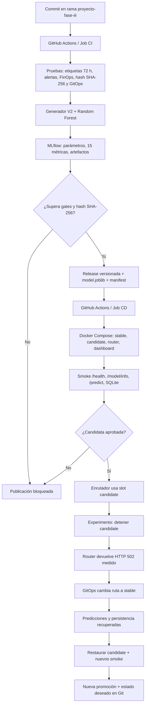
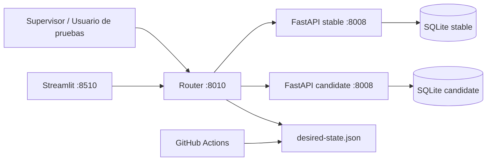
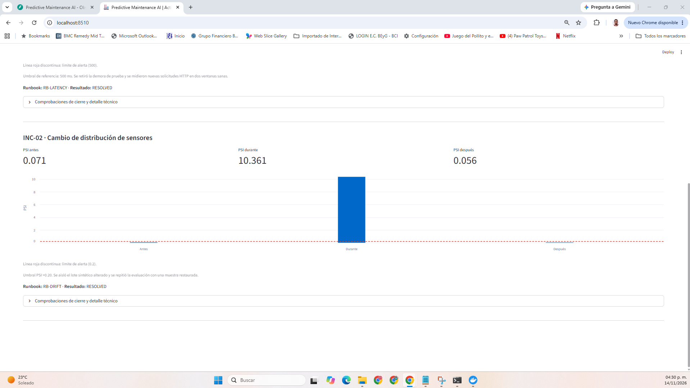
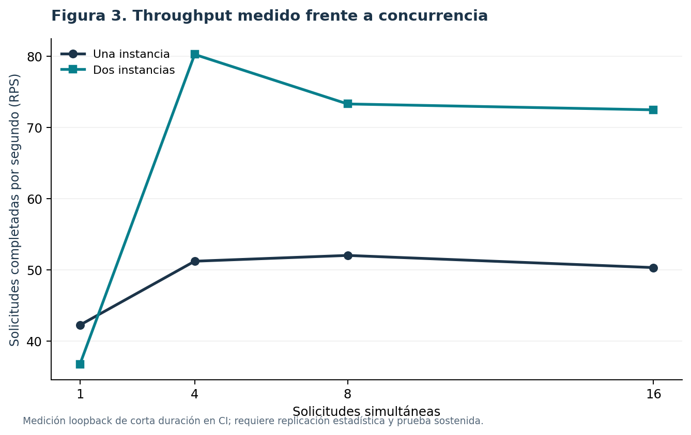
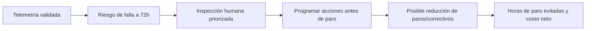

# 🏭 Predictive Maintenance AI | Proyecto Fase III — Resultados
### MLOps · GitOps · Despliegue continuo simulado · Observabilidad · Portfolio técnico-estratégico

[](https://github.com/isaaccg88/PredictiveMaintenance-AI-FaseII/actions/workflows/fase3.yml)

**Universidad Tecmilenio · Gestión de Proyectos de Inteligencia Artificial · Módulo 3 / Semana 12**  
**Rama:** `proyecto-fase-iii` · **Proyecto:** Predictive Maintenance AI · **Caso:** manufacturera mexicana ficticia · **Horizonte del modelo:** 72 horas

> **Alcance comprobado:** sistema académico reproducible con máquinas, fallas y sensores **100% sintéticos**. El CI/CD ejecuta realmente entrenamiento, MLflow, validaciones y un despliegue Docker temporal en GitHub Actions. **No existe despliegue en una fábrica ni en AWS, servicio permanente o mantenimiento físico automático.** GitOps se demuestra mediante estado declarativo, enrutamiento en vivo y rollback en el runner; no constituye un controlador cloud persistente. Las decisiones de mantenimiento y promoción a un entorno real corresponden a personas autorizadas.

## Guía de lectura y correspondencia con la entrega

El profesor solicita: (1) pipeline MLOps/GitOps, (2) documento técnico de operación, (3) portfolio técnico-estratégico y (4) simulación de entrevista. **Los primeros tres están integrados en este README con enlaces a código y evidencia ejecutada. La entrevista oral/video se realizará después y permanece expresamente pendiente.** Esta fase se presenta mediante GitHub: no se genera ZIP ni PDF.

| Criterio de rúbrica (25 puntos c/u) | Secciones donde se demuestra | Estado |
|---|---|---|
| **1. Pipeline de IA (MLOps/GitOps)**: integración, pruebas, versionado, despliegue | 2–5, 10; [workflow reproducible](.github/workflows/fase3.yml) y [últimas ejecuciones](https://github.com/isaaccg88/PredictiveMaintenance-AI-FaseII/actions/workflows/fase3.yml) | **Implementado y ejecutado** en staging efímero |
| **2. Monitoreo, auditoría y optimización**: indicadores y mejora sustentada | 6–8; [auditoría operacional](fase3/evidence/operations_audit.json), [A8](actividad8/evidence/incidents.json), [A9](actividad9/evidence/load_benchmark.json) | **Medido** en piloto sintético y laboratorio |
| **3. Portfolio técnico-estratégico**: problema, arquitectura, valor, resultados, decisiones | 1, 2, 7–9, 11–12; imágenes, tablas y trazas vinculadas | **Documentado**, sin prometer impacto industrial no medido |
| **4. Presentación y preparación profesional**: defensa técnica y gerencial | 13 (preguntas, respuestas y narrativa) | **Preparación realizada; video/entrevista pendiente** |

**Referencia académica:** [Fase II / proyecto original](https://github.com/isaaccg88/PredictiveMaintenance-AI-FaseII/tree/main) · [Actividad 8 — Observabilidad](https://github.com/isaaccg88/PredictiveMaintenance-AI-FaseII/tree/actividad8-v2-observabilidad) · [Actividad 9 — FinOps y gobernanza](https://github.com/isaaccg88/PredictiveMaintenance-AI-FaseII/tree/actividad9-escalabilidad-gobernanza). Las ramas previas se conservan sin mezclarlas.

---

## 1. Resumen ejecutivo y problema industrial

**Problema:** las fallas no previstas interrumpen la producción, incrementan correctivos y dificultan programar mantenimientos. Una alerta anticipada podría ayudar a priorizar inspecciones y decisiones humanas, pero una predicción sin control de versiones, monitoreo ni capacidad de recuperación puede convertirse en otra fuente de riesgo.

**Solución investigada:** un sistema de IA que estima la probabilidad de falla de cada máquina en las siguientes **72 horas**, registra predicciones, presenta riesgos al equipo de mantenimiento y vigila tanto su desempeño de clasificación como la operación del servicio. El alcance académico utiliza 60 máquinas sintéticas y reserva 12 máquinas para una evaluación independiente del ajuste.

**Contribución de Fase III:** cerrar el ciclo técnico demostrando una **línea automatizada de código/datos → entrenamiento → pruebas → MLflow → modelo con huella SHA-256 validada → despliegue de candidata → promoción → detección de fallo → rollback → recuperación auditada**.

| Indicador principal | Resultado comprobado | Qué demuestra y qué NO |
|---|---:|---|
| ROC-AUC de piloto V2 | **0.9655** | Capacidad discriminativa en generador sintético V2; no generalización industrial |
| Precision del piloto | **72.38%** | De cada ventana marcada positiva, proporción verdaderamente positiva en el holdout |
| Recall por ventana | **78.28%** | Ventanas anteriores a falla detectadas; no equivale a recall por evento |
| Recall por evento | **88.57% (31/35)** | Fallas evaluables con al menos una alerta previa en el horizonte |
| Despliegue CI/CD | **2 jobs aprobados** | Modelo validado en MLflow y Docker ejecutado en un runner |
| Recuperación GitOps | **2 promociones, 1 rollback** | Fallo HTTP 502 real y recuperación de tráfico a `stable` |
| Auditoría operacional Fase III | **12 solicitudes; p95 = 43.411 ms** | Muestra breve del API en CI; no acredita SLA 99% industrial |

**Decisión de producto:** el sistema emite estimaciones y recomendaciones de **revisión humana**; nunca detiene ni interviene equipos físicos por su cuenta.

---

## 2. Arquitectura: del prototipo a un ciclo CI/CD verificable



**Figura 1.** Flujo ejecutado de Fase III, no una arquitectura conceptual sin implementación. [Código CI/CD](.github/workflows/fase3.yml) · [Estado deseado publicado](fase3/gitops/desired-state.json) · [bitácora cronológica real](fase3/evidence/deployment_events.json).

### Componentes

| Capa | Implementación real | Función | Limitación |
|---|---|---|---|
| Datos sintéticos | [`actividad8/simulator.py`](actividad8/simulator.py) | Simular sensores, fallas, ventanas y etiquetas futuras | No representa fallas industriales reales |
| Modelado | [`train_v2.py`](actividad8/train_v2.py), scikit-learn | Entrenar Random Forest para 72 h y evaluar por particiones | V2 y V1 no se comparan sobre el mismo generador |
| Registro de experimentos | [MLflow](actividad8/mlflow_audit.py) 3.6 | Parámetros, 15 métricas, artefactos y auditoría | Tracking store creado en el runner |
| Release y gates | [`release.py`](fase3/release.py) | Verificar calidad, SHA-256 y alcance de publicación | Los umbrales son política académica configurable |
| Inferencia | [FastAPI](actividad8/service.py) + Docker | POST /predict, /health, /metrics, /history | Servicios temporales del runner |
| Datos de operación | SQLite por instancia, JSONL, trace_id | Persistencia y rastreabilidad HTTP/inferencia | Bases por instancia: no están replicadas ni son HA |
| Tráfico GitOps | [`router.py`](fase3/router.py) y [`gitops.py`](fase3/gitops.py) | Leer estado declarativo y cambiar slot en vivo | Conmutación push-driven en runner, no operador GitOps continuo |
| Dashboard | [Streamlit](actividad8/dashboard.py) | Resumen, HTTP, alertas, incidentes, trazabilidad | Sin IAM/TLS públicos ni operación permanente |



**Figura 2.** Arquitectura del despliegue Docker de la Fase III. *Las dos API utilizan el mismo binario de modelo con huella SHA-256 validada, pero almacenamientos SQLite separados.* Esto permite demostrar rollback de **tráfico** tras la caída de un contenedor, **no** rollback entre dos versiones distintas del modelo, migración a PostgreSQL ni alta disponibilidad real.

### Puertos de demostración local

| Servicio | Endpoint | Protección de alcance |
|---|---|---|
| API stable | http://localhost:8008/health | Solo loopback |
| API candidate | http://localhost:8009/health | Solo loopback |
| Router GitOps | http://localhost:8010/health | Solo loopback |
| Dashboard Streamlit | http://localhost:8510 | Solo loopback |

El [Compose de Fase III](fase3/compose.yaml) inicia cuatro servicios y mantiene deshabilitada por defecto la inyección de fallas de la Actividad 8. El incidente de Fase III se provoca **deteniendo de verdad el contenedor candidato**, no insertando un 502 ficticio en JSON.

---

## 3. Implementación MLOps: datos, pruebas, MLflow y versionado

### 3.1 Dataset y estrategia de evaluación

El generador V2 crea **129,600 observaciones sintéticas** de 60 máquinas con intervalo de 6 horas. La etiqueta positiva se define cuando ocurre una falla en las siguientes 6–72 horas; las últimas 12 observaciones por máquina se censuran para no utilizar un horizonte futuro incompleto.

Se separan **48 máquinas** para ajuste/validación temporal y **12 máquinas (PM-049 a PM-060)** para evaluación del piloto. El umbral de clasificación **0.50** fue elegido sobre validación, sin optimizarlo contra el piloto. [Metodología detallada](actividad8/docs/METODOLOGIA.md).

### 3.2 Evidencia de desempeño del modelo

| Métrica | Validación | Prueba temporal | Piloto no visto |
|---|---:|---:|---:|
| Precision | 0.6882 | 0.7007 | **0.7238** |
| Recall | 0.8425 | 0.8303 | **0.7828** |
| F1-score | 0.7576 | 0.7600 | **0.7522** |
| ROC-AUC | 0.9760 | 0.9708 | **0.9655** |
| Average Precision | 0.8609 | 0.8530 | **0.8144** |

**Piloto:** TP=346, FP=132, FN=96, TN=4,322; 35 eventos evaluables y 31 detectados. El modelo produce falsas alarmas por ventana, por lo que los equipos requieren reglas de deduplicación y evaluación de impacto operativo. [Resultados originales](actividad8/results/evaluation_v2.json).

**Advertencia comparativa:** Fase II/V1 reportó precision 16.36% y ROC-AUC 0.8621 sobre otro generador. La mejoría numérica de V2 no prueba una mejora controlada de algoritmo: se cambió la distribución generadora. No se presume desempeño industrial.

### 3.3 Automatización y pruebas de integración

El job **continuous-integration** de [GitHub Actions](.github/workflows/fase3.yml) ejecuta:

1. Pruebas de etiquetas futuras, censura, detección de drift, seis reglas de alertas y supresión de duplicados.
2. Pruebas de costos/FinOps, gobernanza del release y transición de estados GitOps.
3. Entrenamiento reproducible V2, evaluación offline y registro de un run real en MLflow.
4. Comprobación cruzada de las **15 métricas MLflow** y sus artefactos contra la evaluación del mismo run.
5. Rechazo si el modelo/metadata no coincide en SHA-256, faltan el horizonte 72 h/holdout 12, o las métricas no alcanzan los límites definidos.
6. Publicación de un artefacto de release versionado, que consume el job de despliegue —no se entrena silenciosamente otro modelo dentro de Docker—.

### 3.4 Baseline de calidad y gates de promoción

| Indicador de release | Baseline piloto medido | Mínimo de promoción | Resultado |
|---|---:|---:|---|
| Precision | **0.723849** | ≥0.70 | PASS |
| Recall por ventana | **0.782805** | ≥0.75 | PASS |
| ROC-AUC | **0.965536** | ≥0.95 | PASS |
| Recall por evento | **0.885714** | ≥0.85 | PASS |
| Horizonte de predicción | **72 h** | Exactamente 72 h | PASS |
| Máquinas holdout | **12** | Exactamente 12 | PASS |
| Integridad de artefacto | SHA-256 calculado | Coincide con metadata/manifest | PASS |

**Integridad ≠ firma digital:** SHA-256 permite comprobar que el archivo no cambió respecto al manifest. **No se implementó una firma criptográfica autenticada con clave privada**, ni cadena de confianza de una registry. Esta distinción forma parte de la auditoría de seguridad.

**Criterio técnico:** estos límites son políticas académicas explícitas diseñadas para el experimento, no umbrales regulatorios ni garantías industriales. El [código de gating](fase3/release.py) hace fallar la ejecución si se degrada una métrica o se modifica el binario. Las [pruebas unitarias](fase3/test_phase3.py) verifican también que un release degradado o manipulado sea rechazado.

### 3.5 MLflow e integridad SHA-256 del artefacto

<!-- F3-RELEASE-START -->
<details>
<summary>Manifest de la última release validada</summary>

- **Versión:** `v2-849ad06d182b`
- **SHA-256 completo:** `849ad06d182b07d578d3adf0117543953fda063a47ef56e8e60be3d3dfb3b79f`
- **Experimento MLflow:** `PredictiveMaintenanceAI_Actividad8_V2`
- **Run MLflow de esta ejecución:** `3c61be3957d54d2783b0c4f789f3926d`
- **Commit origen:** `e719a5a14fd5436a53844ed3394b5febc9aab537`
- **Alcance:** `academic_staging_only` (autorización industrial = `false`)
- **GitHub Actions:** [ejecución #45218317927](https://github.com/isaaccg88/PredictiveMaintenance-AI-FaseII/actions/runs/45218317927)

</details>

[JSON de release](fase3/evidence/release_manifest.json) · [MLflow auditado por el pipeline](actividad8/mlflow_audit.py) · [Evidencia operativa](fase3/evidence/operations_audit.json).
<!-- F3-RELEASE-END -->

La [evidencia de release](fase3/evidence/release_manifest.json) contiene el hash completo, seed, evaluación, gates, run MLflow y commit Git de origen. La coincidencia se verifica **antes** del despliegue. El modelo serializado se publica como artefacto temporal de Actions; **no** se incorpora su binario a Git sin necesidad.


**Figura 3.** Evidencia histórica real de la interfaz MLflow del laboratorio de la Actividad 8. Fase III realiza una nueva auditoría programática del tracking store en su propio CI; esta captura no se presenta como pantalla de la ejecución nueva.

[Ejecuciones de Fase III](https://github.com/isaaccg88/PredictiveMaintenance-AI-FaseII/actions/workflows/fase3.yml) · [Auditoría MLflow reutilizada](actividad8/mlflow_audit.py).

---

## 4. GitOps/CD: despliegue, promoción, incidente y recuperación

### 4.1 ¿Cómo funciona?

El job **continuous-deployment** solo comienza después de la aprobación del CI. Descarga el modelo cualificado, verifica nuevamente su huella, crea estado deseado inicial `stable`, construye los cuatro contenedores y realiza peticiones HTTP reales contra la API y el router.

Se comprueban `/health`, `/model/info`, el conjunto de **12 máquinas**, **3 predicciones distintas**, sus `trace_id` y los registros persistidos en SQLite. Solo con estas comprobaciones aprobadas se autoriza cambiar la ruta a `candidate`.

El router lee [`desired-state.json`](fase3/gitops/desired-state.json), por lo que las transiciones de slots producen un cambio observable en el encabezado HTTP `X-Serving-Slot`. El estado final aprobado se conserva en Git junto con la bitácora y los resultados; **Git documenta y controla el estado del experimento, pero no hay un agente GitOps externo observando permanentemente el repositorio**.

### 4.2 Secuencia comprobada por GitHub Actions

| Paso | Evidencia | Resultado |
|---|---|---|
| 1. Inicialización | [Bitácora GitOps](fase3/evidence/deployment_events.json) | `active_slot=stable` |
| 2. Prueba de candidata | [Smoke candidate](fase3/evidence/candidate_smoke.json) | 3 predicciones y persistencia PASS |
| 3. Primera promoción | [Router promovido](fase3/evidence/router_promoted.json) | `active_slot=candidate`, 3 predicciones |
| 4. Falla controlada | [Fallo HTTP](fase3/evidence/router_failure.json) | **502 observado**, candidata detenida |
| 5. Rollback de tráfico | [Router restaurado](fase3/evidence/router_restored.json) | `active_slot=stable`; 3 predicciones PASS |
| 6. Recuperación de candidata | [Smoke candidate](fase3/evidence/candidate_smoke.json) | Contenedor reiniciado, validación PASS |
| 7. Re-promoción final | [Router final](fase3/evidence/router_final.json) | `active_slot=candidate`; 3 predicciones PASS |
| 8. Auditoría | [Reporte operativo](fase3/evidence/operations_audit.json) | **2 promociones y 1 rollback** registrados |

**Dato técnico destacado:** el fallo se observó realmente como HTTP **502**, no como una fila escrita a mano. [Los eventos](fase3/evidence/deployment_events.json) registran la primera promoción a las 16:24:10 UTC, el rollback a las 16:24:12 UTC y la nueva promoción a las 16:24:15 UTC del 23 de noviembre de 2026. Son timestamps de **ejecución del laboratorio**; no equivalen al MTTR de una planta ni se extrapolan a otro entorno.

**Condición de salida:** la ejecución falla si el servicio no arranca, el SHA no coincide, faltan inferencias persistidas, la candidata no puede promocionarse, no se observa HTTP 502 después de detenerla, no se recupera el servicio en `stable` o no se restablece `candidate`.

### 4.3 Qué se automatizó y qué no

| Capacidad | Estado |
|---|---|
| CI ante push a la rama de Fase III | Automatizado |
| Entrenamiento, auditoría MLflow, versionado y gates | Automatizado |
| Despliegue Docker temporal de 2 API + router + dashboard | Ejecutado |
| Promoción y rollback del **enrutamiento** | Ejecutado y auditado |
| Rollback entre **dos modelos distintos** | No demostrado; los dos slots usan el mismo binario |
| Autoescalado/AWS, persistencia compartida, failover multizona | Solo diseño propuesto en Actividad 9 |
| Aprobaciones corporativas, seguridad IAM, operatividad 24/7 | Pendiente de un escenario industrial real |
| Mantenimiento físico automatizado | No permitido en el piloto |

**Decisión:** esta implementación prueba técnicamente una **entrega continua simulada** en entorno efímero. No debe denominarse producción ni GitOps reconciliado desde un cluster externo.

---

## 5. Documento técnico de operación y runbooks

### 5.1 Operación de la solución

| Operación | Endpoint/artefacto | Responsable propuesto |
|---|---|---|
| Comprobar salud, carga de modelo y horizonte | `GET /health` · `GET /model/info` | SRE |
| Consultar máquinas y solicitar predicción | `GET /machines` · `POST /predict` | Mantenimiento |
| Auditar latencia y solicitudes HTTP | `GET /metrics`; registros estructurados | SRE |
| Consultar inferencias persistidas | `GET /history`; SQLite | MLOps / SRE |
| Revisar características y métricas | MLflow + `evaluation_v2.json` | ML Lead |
| Investigar drift, incidentes y error budget | Dashboard y [A8](actividad8/evidence/incidents.json) | ML Lead / SRE |
| Aprobar cambios de release, gates y rollback | [CI/CD de Fase III](.github/workflows/fase3.yml) | ML Lead / Product Owner |
| Supervisar impacto económico | [FinOps de A9](actividad9/evidence/finops_model.json) | FinOps / Product Owner |

**Runbook de recuperación del despliegue:**

1. Comprobar release/hash, `/health` y el slot en `GET router:8010/health`.
2. Si candidata está disponible, ejecutar [smoke](fase3/smoke.py) y comparar trazas con `/history`; promocionar **únicamente** después de PASS.
3. Si el router devuelve 502 por caída de candidata, registrar la solicitud y ejecutar [rollback](fase3/gitops.py) al slot estable.
4. Repetir tres predicciones y comprobar que los `trace_id` aparecen en SQLite. Cerrar la incidencia solo tras verificar servicio recuperado.
5. Investigar logs, recuperar la candidata, repetir gates y promocionar de nuevo; conservar [la bitácora](fase3/evidence/deployment_events.json).
6. Si `stable` también falla, **escalar a SRE** y no declarar recuperación. Este laboratorio no prueba restauración de una base de datos común ni disaster recovery.

### 5.2 Monitoreo de referencia (baseline) y niveles de servicio

Se utiliza el histórico medido de la Actividad 8 para establecer **antes → incidente → después**. Son mediciones del laboratorio sintético y no benchmarks de AWS.

| Indicador | Baseline normal | Umbral/objetivo configurado | Incidente | Recuperación |
|---|---:|---|---:|---:|
| Disponibilidad HTTP | 100% | SLO ≥99% | 100% en falla de latencia A8 | 100% |
| Oportunidad HTTP 2xx ≤500 ms | 100% | SLO ≥99% | 0% en INC-01 | 100% |
| Latencia p95 | **35.89 ms** | Diagnóstico 500 ms; alerta por SLI | **689.22 ms** | 37.22 ms |
| Errores HTTP 5xx | 0% | Alerta >1% | 0% en INC-01 | 0% |
| PSI de temperatura | **0.071** | Alerta >0.20, N≥100 | **10.361** | 0.056 |
| Calidad ROC-AUC offline | **0.9655** | Alerta propuesta <0.75 con etiquetas maduras | No simulada | No evaluada |

El p95 no sustituye el SLI de oportunidad. Con 12 peticiones, un error consume más que todo el presupuesto de error del 1% de esa ventana; ello es **didáctico** y no un presupuesto mensual representativo. [Baseline detallado](https://github.com/isaaccg88/PredictiveMaintenance-AI-FaseII/blob/actividad8-v2-observabilidad/README.md#4-diseño-de-monitoreo-métricas-logs-y-trazas).

### 5.3 Auditoría operacional nueva de Fase III

<!-- F3-OPERATIONS-START -->
| Campo medido en última ejecución #45218317927 | Resultado |
|---|---:|
| Backend `/predict` registrado | **12 solicitudes** |
| Respuestas HTTP 5xx del backend | **0** |
| Disponibilidad backend de la muestra | **100.0%** |
| Oportunidad backend de la muestra | **100.0%** |
| Latencia p95 backend | **34.250 ms** |
| Caída observada desde router (fuera del contador backend) | **HTTP 502** |
| Transiciones verificadas | **2 promociones y 1 rollback** |
| Slot final | **`candidate`** |

Estas cifras proceden de [la misma ejecución aprobada](https://github.com/isaaccg88/PredictiveMaintenance-AI-FaseII/actions/runs/45218317927); no son promedios de un servicio permanente. El error 502 se conserva en el [smoke del router](fase3/evidence/router_failure.json), por separado de `/metrics` del backend apagado.
<!-- F3-OPERATIONS-END -->

[JSON original de auditoría](fase3/evidence/operations_audit.json) · [Fallo observado por el router](fase3/evidence/router_failure.json) · [Comprobación después del rollback](fase3/evidence/router_restored.json).

**Matiz estadístico:** doce solicitudes de prueba y un único runner no acreditan un SLA de 99% ni un tiempo de recuperación operativo. El error 502 del router **no entra** en el contador `/metrics` del backend cuando el backend está apagado; por ello se conserva en una evidencia independiente. El diseño industrial necesitaría métricas agregadas desde el borde.

### 5.4 Logs y trazabilidad de una predicción

Cada `POST /predict` genera `trace_id`, duración, estatus, identificador de máquina, probabilidad y registro SQLite. Una solicitud puede seguirse mediante eventos `model.infer` → `sqlite.commit` → `http.request`. El dashboard no necesita acceder a contraseñas o datos personales para hacerlo en este caso sintético.

[Traza HTTP correlacionada preservada](actividad8/evidence/ejemplo_traza_real.json) · [Código de instrumentación](actividad8/service.py) · [Logs de contenedores del CD](fase3/evidence/containers.log).


**Figura 4.** Interfaz real capturada en la Actividad 8 (vista ilustrativa del mismo stack). En Fase III el dashboard se vuelve a levantar automáticamente, pero la imagen no pretende ser una captura específica del job #45215668864.

---

## 6. Auditoría y optimización del sistema

### 6.1 Resultado del incidente de latencia y data drift


**Figura 5.** La latencia p95 aumentó de **35.9 ms a 689.2 ms** al inyectar demora temporal y bajó a **37.2 ms** tras retirarla; el runbook RB-LATENCY exigió nuevas ventanas saludables antes de RESOLVED.



**Figura 6.** El PSI de temperatura evolucionó de **0.071 a 10.361 y posteriormente 0.056**. Aislar el lote sintético restableció una distribución estable: esto **no** demuestra por sí solo recuperación del ROC-AUC, que necesita etiquetas maduras.

### 6.2 Mejoras de capacidad observadas en la Actividad 9

La Actividad 9 comparó HTTP con una y dos API sobre **el mismo runner**, con 60 solicitudes por ventana, por lo que son resultados operativos de corta duración y no pruebas de alta disponibilidad cloud.

| Concurrencia 4 | Una API | Dos API | Interpretación |
|---|---:|---:|---|
| Throughput | 52.83 req/s | 95.56 req/s | **+80.9%** observado en esa corrida |
| p95 | 89.8 ms | 51.4 ms | Menor latencia en dos procesos para esa prueba |
| Respuestas oportunas | 100% | 100% | Muestra insuficiente para acreditar SLO 99% industrial |



**Figura 7.** La segunda API ofrece mayor capacidad en el host de ensayo; no supone una ganancia lineal ni prueba escalabilidad en ARM o en múltiples zonas. [Datos completos de benchmark](actividad9/evidence/load_benchmark.json).

### 6.3 Costos y optimización FinOps

En el escenario **hipotético de 10 millones de solicitudes mensuales**, el modelo FinOps propone:

| Arquitectura modelada | USD/mes | Condición |
|---|---:|---|
| Cloud básica x86 | **131.46** | Sin redundancia/HA |
| HA x86 sin right-sizing | **217.50** | 2 tareas API, supuesto Multi-AZ |
| HA ARM con right-sizing | **170.65** | 2 tareas API; compatibilidad y desempeño ARM pendientes |

La comparación de HA x86 contra HA ARM genera un ahorro **estimado** de **21.5%**, no realizado. El cálculo excluye componentes como NAT, WAF, respaldos, soporte y personal, y no demuestra que ARM cumpla el mismo SLO bajo carga real. [Fórmulas y supuestos](actividad9/finops.py) · [datos](actividad9/evidence/finops_model.json).


**Figura 8.** Las curvas de costo muestran decisiones de infraestructura **propuestas**, no facturación real. La elección debe condicionarse a mediciones cloud con límites reales, seguridad y presupuesto aprobado.

### 6.4 Sesgos técnicos y vigilancia de desempeño entre equipos

| Tipo de máquina sintética | Recall | FPR | Máquinas distintas |
|---|---:|---:|---:|
| A | 72.54% | 3.01% | 4 |
| B | 80.13% | 2.59% | 4 |
| C | 81.94% | 3.29% | 4 |

La brecha TPR máxima es **9.41 puntos porcentuales**. Se recomputaron intervalos exploratorios bootstrap por máquina, pero únicamente cuatro máquinas por tipo impiden concluir paridad estadística industrial. No hay atributos personales/demográficos; esto es **fairness operacional por tipo de máquina**.


**Figura 9.** El tipo A presenta menor recall descriptivo. La decisión propuesta es investigar la brecha con más equipos independientes y etiquetas maduras antes de autorizar cualquier uso industrial. [Auditoría reproducible](actividad9/evidence/fairness_machine_types.json).

### 6.5 Registro de acciones y próximas optimizaciones

| Decisión | Justificación cuantitativa | Acción realizada o recomendada |
|---|---|---|
| Mantener el modelo V2 evaluado | ROC-AUC 0.9655, recall por evento 88.57%, solo sintético | **Realizado:** release bajo gates, MLflow y SHA |
| Fortalecer respuesta a fallos HTTP | A8: p95 689 ms durante inyección; F3: router 502 al detener candidate | **Realizado:** runbooks A8 y rollback de enrutamiento F3 |
| Controlar data drift | PSI 10.361 frente al umbral 0.20 | **Realizado:** cuarentena y medición de recuperación sintética |
| Dimensionar y controlar costo cloud | HA ARM US$170.65 vs HA x86 US$217.50 hipotéticos | **Propuesto:** pruebas ARM y presupuesto AWS completo |
| Reducir brecha de recall por tipo | TPR gap 9.41 puntos, 4 máquinas/tipo | **Propuesto:** evaluación con más unidades independientes |
| Hacer verdaderamente resiliente el sistema | SQLite separada por réplica y una sola máquina de CI | **Pendiente industrial:** DB compartida, despliegue multi-AZ, seguridad IAM/TLS, observabilidad central |

---

## 7. Portfolio técnico-estratégico: valor para la empresa

### 7.1 Propuesta de valor

**Usuarios:** técnicos de mantenimiento, supervisores de planta, operaciones y responsables de TI/MLOps. El sistema prioriza inspecciones con información de riesgo a 72 horas y puede apoyar decisiones de programación; la decisión final permanece con el personal responsable.

**Cadena de impacto propuesta:**



Los primeros tres pasos tienen **componentes técnicos demostrados con datos sintéticos**; los dos últimos **requieren un piloto industrial** para validar causalidad e impacto económico.

### 7.2 Ejemplo financiero de sensibilidad, NO ahorro realizado

Para discutir valor de negocio se plantea un ejemplo **hipotético**: costo de paro = MXN **18,000 por hora** y costo marginal de intervención preventiva = MXN **12,000 por evento**. **No son costos extraídos de una planta ni resultados observados.**

| Horas de paro efectivamente evitadas | Beneficio bruto supuesto | Costo preventivo supuesto | Beneficio neto ilustrativo |
|---|---:|---:|---:|
| 2 h | MXN 36,000 | MXN 12,000 | **MXN 24,000** |
| 4 h | MXN 72,000 | MXN 12,000 | **MXN 60,000** |
| 6 h | MXN 108,000 | MXN 12,000 | **MXN 96,000** |

**Fórmula:** `beneficio_neto = horas_realmente_evitadas × costo_hora − costo_intervención − costos_de_falsas_alarmas − costo_operativo_de_la_IA`. La tabla omite los últimos dos términos para ejemplificar la sensibilidad, por lo que **no representa ROI calculado**. Para medir valor real se requieren datos de paros, costos de refacciones, inspecciones fallidas, fallas no detectadas y una comparación controlada antes/después.

### 7.3 Decisiones de producto y arquitectura justificadas

- **72 horas de horizonte:** permite explorar decisiones antes de una falla sin activar mantenimiento físico autónomo; las etiquetas se generan solo con futuros eventos sintéticos.
- **Modelo Random Forest con ingeniería de variables:** elegido por su capacidad de clasificación tabular; el piloto revela compromisos entre precision y recall.
- **FastAPI y Streamlit:** separación de inferencia e interfaz; APIs medidas y observables.
- **MLflow + GitHub Actions:** trazabilidad de parámetros, resultados y releases en un ejercicio reproducible.
- **SHA-256 + gates:** prevenir que el entorno de staging use un artefacto diferente al evaluado.
- **Router + dos contenedores:** hacer visible el riesgo de una candidata caída y demostrar recuperación sin declarar HA.
- **FinOps y responsible AI:** el costo unitario, la calidad por grupos, la privacidad y los SLO deben evaluarse **conjuntamente**, no como métricas aisladas.

### 7.4 Riesgos estratégicos

| Riesgo | Consecuencia | Control/gate propuesto |
|---|---|---|
| Sobreajuste al generador sintético | Métricas optimistas fuera del laboratorio | Piloto con sensores reales y nuevas etiquetas |
| Falsos negativos/positivos | Paros no anticipados o inspecciones innecesarias | Costos por episodio, recall por evento y revisión humana |
| Drift en condiciones de operación | Degradación silenciosa | PSI, nuevas cohortes, quality gates con etiquetas maduras |
| Pérdida de datos/caída del backend | Trazabilidad incompleta | Migrar de SQLite local a DB robusta compartida |
| Errores en cambio de versión | Predicciones no disponibles | Canary, validaciones, enrutamiento reversible y rollback real de modelo |
| Gastos cloud subestimados | Proyecto financieramente inviable | AWS Calculator, presupuestos, alarmas y costo por inferencia |
| Datos personales en implantación futura | Riesgo legal/privacidad | Inventario de datos, minimización, controles IAM y revisión jurídica |

---

## 8. Gobernanza, auditoría y ciclo de vida responsable

**Gobernanza técnica:** modelo y dataset etiquetados como sintéticos; evidencia de evaluación segregada, huellas verificadas, permisos de GitHub Actions acotados por job, monitoreo separado de incidentes y bitácora inmutable a nivel de commits del repositorio (sujeta a permisos Git). Los archivos JSON contienen trazabilidad; no constituyen por sí solos un sistema de auditoría corporativo antifraude.

**Gobernanza humana:** el ML Lead aprueba validez y riesgos del modelo; SRE valida infraestructura/SLO; Product Owner decide presupuesto y aceptación operativa; Legal/Security evalúan la pertinencia de protección de datos. Ningún resultado sintético permite certificar cumplimiento de una fábrica.

**Marcos de orientación:** NIST AI RMF (GOVERN, MAP, MEASURE, MANAGE), ISO/IEC 42001 y, en caso de introducir información de trabajadores, la normativa mexicana de protección de datos personales aplicable. Son referencias para diseñar controles, no certificaciones obtenidas.

### Plan de transición posterior a la Fase III

| Etapa | Producto verificable | Criterio de avance |
|---|---|---|
| 0. CI/CD académico | Releases, gates, logs, canary, rollback de tráfico | **Completado en Actions** |
| 1. Staging real controlado | Backend DB compartida, secretos, TLS, CI de seguridad, despliegue a nube | Revisión técnica y costos aprobados |
| 2. Datos industriales | Inventario de sensores, calidad, fallas etiquetadas y evaluación temporal externa | Calidad por sitio/tipo, riesgos aceptados |
| 3. Experimento operativo | Operadores comparan predicción con proceso convencional | Reducción de paros y falsas alarmas medible |
| 4. Producción supervisada | SLO mensual, MLOps completo, DR, alertas, roles y costos | Autorización empresarial, legal y operacional |

---

## 9. Portfolio profesional: historia del proyecto y resultados defendibles

| Fase / actividad | Pregunta del negocio o tecnología | Lo construido o aprendido |
|---|---|---|
| **Fase I** | ¿Es pertinente abordar las fallas con IA? | Problema, alcance, usuarios, propuesta de valor y horizonte de 72 h |
| **Fase II** | ¿Puede operar un servicio de predicción integral? | Dataset/modelo sintético, FastAPI, persistencia, Docker, frontend y pruebas |
| **Actividad 8** | ¿Cómo sabemos si servicio y modelo se degradan? | Baseline, SLO, seis reglas, MLflow, PSI, dos incidentes con runbooks |
| **Actividad 9** | ¿Cómo crecer sin perder costo, fiabilidad y gobernanza? | Benchmark de carga, rediseño AWS simulado, FinOps, fairness A/B/C |
| **Fase III** | ¿Podemos construir, probar, liberar y recuperar versiones de modo controlado? | **CI/CD funcional** con release con hash SHA-256 verificado, gate, Docker, smoke, promociones, 502 real, rollback y auditoría |

**Aprendizaje transversal:** un buen valor de ROC-AUC no es suficiente para justificar una adopción industrial. La IA debe ser **reproducible, observable, económicamente evaluable, operable y gobernada**. Ese es el principal resultado de gestión del proyecto.

---

## 10. Reproducibilidad, código y evidencia

### Estructura principal de la Fase III

```text
.github/workflows/fase3.yml      # CI + CD GitOps simulado
fase3/
  release.py                    # gates de calidad y huella del modelo
  gitops.py                     # desired state / promote / rollback
  router.py                     # forwarding HTTP según slot
  smoke.py                      # salud, inferencia, modelo, SQLite
  ops_audit.py                  # auditoría de servicio y routing
  test_phase3.py                # pruebas de rechazo, hash, estado
  compose.yaml                  # 2 API + router + dashboard
  docker/                       # imágenes con artefacto ya evaluado
  gitops/desired-state.json     # estado declarativo final publicado
  evidence/                     # release, smokes, incidentes y auditoría
actividad8/                     # dataset, modelo, MLflow, observabilidad
actividad9/                     # costos, benchmarking y fairness
```

**Forma más sencilla de verificar:** abrir el [workflow de Fase III](https://github.com/isaaccg88/PredictiveMaintenance-AI-FaseII/actions/workflows/fase3.yml), elegir una ejecución completada y revisar ambos jobs y sus artefactos. Las evidencias principales también están versionadas en `fase3/evidence/` para no depender exclusivamente de la caducidad de artefactos de Actions.

### Reproducir en Windows (con Git, Python 3.11 y Docker Desktop)

```powershell
git clone --branch proyecto-fase-iii https://github.com/isaaccg88/PredictiveMaintenance-AI-FaseII.git PredictiveMaintenance-FaseIII
cd PredictiveMaintenance-FaseIII

python -m pip install -r actividad8/requirements.txt
python -m pytest actividad8/test_activity8.py actividad9/test_activity9.py fase3/test_phase3.py -q

python -m actividad8.train_v2 --mlflow
python -m actividad8.mlflow_audit
python -m fase3.release

python -m fase3.gitops init
docker compose -f fase3/compose.yaml up --build -d --wait
python -m fase3.smoke --url http://127.0.0.1:8008 --out fase3/evidence/stable_local.json
python -m fase3.smoke --url http://127.0.0.1:8009 --out fase3/evidence/candidate_local.json
python -m fase3.gitops promote --validation fase3/evidence/candidate_local.json
python -m fase3.smoke --url http://127.0.0.1:8010 --expected-slot candidate --out fase3/evidence/router_local.json

# Al finalizar:
docker compose -f fase3/compose.yaml down
```

Para repetir **el rollback** debe detenerse el contenedor `api-candidate`, verificar el HTTP 502 con `--expect-failure`, ejecutar `gitops rollback` con la evidencia de ese fallo y repetir la prueba del router. El procedimiento exacto y automático está en [.github/workflows/fase3.yml](.github/workflows/fase3.yml). **Evitar utilizar comandos de inyección fuera del laboratorio**.

### Trazabilidad de evidencias verificables

| Requisito | Evidencia específica |
|---|---|
| Fuente y tests de CI/CD | [Workflow](.github/workflows/fase3.yml) · [pruebas](fase3/test_phase3.py) |
| Modelo versionado y auditado | [Manifest](fase3/evidence/release_manifest.json) · [MLflow](actividad8/mlflow_audit.py) |
| Infraestructura declarativa | [Compose](fase3/compose.yaml) · [Desired state](fase3/gitops/desired-state.json) |
| Promoción, falla y rollback | [Eventos](fase3/evidence/deployment_events.json) · [HTTP 502](fase3/evidence/router_failure.json) · [recuperación](fase3/evidence/router_restored.json) |
| Operación y métricas | [Auditoría F3](fase3/evidence/operations_audit.json) · [historial A8](actividad8/evidence/incidents.json) |
| Evidencia visual del dashboard | [Capturas A8](actividad8/docs/EVIDENCIAS_VISUALES.md) |
| MLflow de etapa previa | [Capturas MLflow A8](actividad8/docs/MLFLOW_EVIDENCIA.md) |
| Performance/FinOps/fairness | [Benchmark](actividad9/evidence/load_benchmark.json) · [Costos](actividad9/evidence/finops_model.json) · [Grupos A/B/C](actividad9/evidence/fairness_machine_types.json) |
| Ejecución auditada de Fase III | [Workflow de Fase III](https://github.com/isaaccg88/PredictiveMaintenance-AI-FaseII/actions/workflows/fase3.yml) |

---

## 11. Evaluación crítica: fortalezas y limitaciones

**Fortalezas demostradas:** gates de calidad verificables, versionado por hash, MLflow auditado, dos slots ejecutándose en Docker, enrutamiento dinámico, predicciones persistidas y recuperación comprobada ante falla HTTP real, con un historial GitOps versionado. La arquitectura integra evidencia técnica y financiera de proyectos anteriores sin modificar sus ramas.

**Limitaciones materialmente importantes:**

1. Solo existen **datos sintéticos**, sin rendimiento validado en máquinas reales.
2. `stable` y `candidate` usan el **mismo modelo**; está validado el rollback de **ruta**, no la reversión de una versión ML diferente.
3. El estado GitOps se genera y publica desde el job; **no** existe un agente externo que sondee Git continuamente ni un despliegue permanente de nube.
4. El runner se destruye al finalizar: los cuatro servicios dejan de estar disponibles, salvo su código/evidencias.
5. Cada API tiene **SQLite independiente**; las predicciones no se replican entre slots.
6. Las doce solicitudes observadas por el backend en esta auditoría no demuestran un SLA mensual, y el router 502 debe contarse separadamente si se evalúa disponibilidad desde el usuario.
7. La estimación de costos de A9 no incluye TCO completo; la fairness de A9 se evaluó con cuatro máquinas por tipo.
8. La aplicación no implementa aún autenticación empresarial, gestión de secretos, auditoría centralizada, backups automáticos o pruebas de desastre de una infraestructura real.

**Conclusión técnica:** se alcanzó un entorno de **MLOps/GitOps académico ejecutable y reproducible**, con criterios de aceptación verificables. Se documenta una trayectoria razonable hacia la industria, pero no se afirma que la implementación sea ya una solución industrial certificada.

---

## 12. Conclusiones estratégicas

1. **Valor técnico:** el proyecto superó la etapa de entrenamiento aislado y demuestra un proceso controlado para generar y ejecutar versiones evaluadas de un modelo.
2. **Confiabilidad:** el laboratorio demuestra que una falla de servicio puede observarse y revertirse mediante cambio de ruta; el reto industrial restante es mantener consistencia de datos y realizar rollback entre modelos/versiones distintos.
3. **Gobernanza:** el hash, la trazabilidad MLflow, los tests de etiquetas y gates hacen auditable qué se entrenó y qué se ejecutó. Sin aprobación y datos reales no constituyen un certificado de calidad.
4. **Costos y escalabilidad:** la arquitectura propuesta debe contrastar costo total con SLO real. Los escenarios FinOps son herramientas de decisión, no presupuestos confirmados.
5. **Decisión de negocio:** antes de operar en una planta, la siguiente inversión prioritaria debe enfocarse en calidad de datos industriales, seguridad, persistencia robusta, ensayos de falla y una prueba controlada de reducción neta de paros.

---

## 13. Preparación de entrevista técnica y gerencial — VIDEO PENDIENTE

**Estado de entrega:** se preparan argumentos y preguntas; **todavía no existe una grabación y no se inventa un enlace**. La simulación oral se realizará posteriormente, conforme a la decisión del estudiante. Esta es la única pieza deliberadamente no ejecutada de la Fase III.

### Narrativa propuesta para presentar el portfolio (8–10 minutos)

| Minutos orientativos | Contenido | Evidencia que se debe mostrar |
|---|---|---|
| 0:00–1:00 | Problema de paros no planificados y valor de anticipar 72 h | Resumen ejecutivo y figura 1 |
| 1:00–2:30 | Arquitectura/modelo, generación y evaluación sin fuga temporal | Tabla de métricas y figura 2 |
| 2:30–4:30 | MLOps: pruebas, MLflow, release y versionado SHA | GitHub Actions y manifest |
| 4:30–6:00 | GitOps: candidatura, promoción, 502 real y rollback | JSON del fallo, bitácora y router restaurado |
| 6:00–7:30 | Monitoreo, PSI, latencia, fairness y costos FinOps | Figuras 5–9 |
| 7:30–9:00 | Limitaciones, riesgos, próximos pasos y decisión de inversión | Secciones 7, 8 y 11 |
| 9:00–10:00 | Preguntas y defensa del diseño | Respuestas técnicas y de gestión |

### Banco de preguntas para la futura entrevista

**1. ¿Por qué esta solución necesita IA y no solo reglas de mantenimiento?**  
Las señales precursoras combinan desgaste, temperatura y vibración con variaciones y falsas anomalías; la IA permite estimar riesgo multivariable. Sin embargo, todavía debe demostrarse que supera un mantenimiento basado en reglas/costos sobre datos industriales.

**2. ¿Qué significa predecir fallas a 72 horas?**  
La etiqueta mira si hay fallo en las próximas 6–72 h. El algoritmo entrega probabilidad para un snapshot, no la hora exacta de falla.

**3. ¿Cómo evitaste fuga de información?**  
Las etiquetas se construyen mirando eventos futuros solo al definir el target; las features representan variables presentes/pasadas. Se usa separación temporal, se censura el horizonte incompleto, se ajusta preprocessing solo en entrenamiento y se reserva el piloto de 12 máquinas.

**4. ¿Por qué tienes ROC-AUC 0.9655 y no afirmas que sea listo para industria?**  
Porque el conjunto está generado con relaciones diseñadas. Es evidencia de la implementación del modelo en ese entorno, no una garantía fuera de distribución ni validación en una fábrica real.

**5. ¿Cómo garantizas que se despliegue exactamente el modelo aprobado?**  
El job CI calcula SHA-256 y registra métricas y artefactos. El CD descarga el mismo artefacto, verifica su hash antes de Docker y exige que `GET /model/info` exponga el hash esperado.

**6. ¿Es GitOps real?**  
Es una implementación GitOps **simulada**, con estado deseado versionado y un router que lo lee para realizar cambios efectivos en tráfico. No hay un operador Kubernetes/Argo CD observando Git ni persistencia cloud.

**7. ¿Qué hizo el rollback y qué no hizo?**  
Tras detener la candidata hubo HTTP 502 real. El estado cambió a stable y se verificaron tres predicciones persistidas. No cambió la versión ML porque ambos slots usan el mismo binario.

**8. ¿Qué sucedería si la versión nueva mejora ROC-AUC pero aumenta latencia?**  
Los gates actuales se complementan con pruebas de API; antes de producción deben existir límites de p95/oportunidad y costo por predicción sobre carga representativa. Un mejor ROC-AUC no justifica degradar un SLO crítico.

**9. ¿Cómo se distingue data drift de degradación del modelo?**  
PSI compara distribución de entradas sin etiquetas; una caída de ROC-AUC requiere etiquetas maduras. Un PSI elevado es señal de investigación, no prueba automática de peor precisión.

**10. ¿Cómo estimarías el ROI?**  
Primero mediría horas de paro efectivamente evitadas y costo horario, restando correctivos/preventivos, falsas alarmas y TCO de IA. El ejemplo numérico del portfolio es sensibilidad hipotética, no retorno demostrado.

**11. ¿Qué te preocuparía más al escalar?**  
Persistencia compartida, seguridad y trazabilidad del release, presupuesto completo, etiquetas reales y resiliencia entre zonas; hoy los slots tienen SQLite independientes.

**12. ¿Cuál sería tu condición de no-go industrial?**  
Falta de datos/etiquetas confiables, incumplimiento sostenido de SLO, costos no aprobados, ausencia de rollback de modelo efectivo, incidentes sin responsables o riesgos legales sin mitigar.

### Evidencia oral pendiente

**Video o enlace a simulación:** **PENDIENTE**. Cuando se grabe, se incorporará aquí el enlace y un resumen de la entrevista, sin reemplazar los resultados verificables del código.

---

### Referencias técnicas

- [GitHub Actions — workflow y ejecuciones de Fase III](https://github.com/isaaccg88/PredictiveMaintenance-AI-FaseII/actions/workflows/fase3.yml)
- [MLflow Tracking](https://mlflow.org/docs/latest/ml/tracking/)
- [Google SRE — Implementing SLOs](https://sre.google/workbook/implementing-slos/)
- [FinOps Framework](https://www.finops.org/framework/phases/)
- [NIST AI RMF](https://airc.nist.gov/airmf-resources/airmf/5-sec-core/)
- [ISO/IEC 42001](https://www.iso.org/standard/42001)
- [Ley Federal de Protección de Datos Personales en Posesión de los Particulares — México](https://www.diputados.gob.mx/LeyesBiblio/pdf/LFPDPPP.pdf)

**Sello del proyecto:** evidencia antes que afirmaciones; métricas medibles antes que promesas; supervisión humana ante decisiones industriales.
