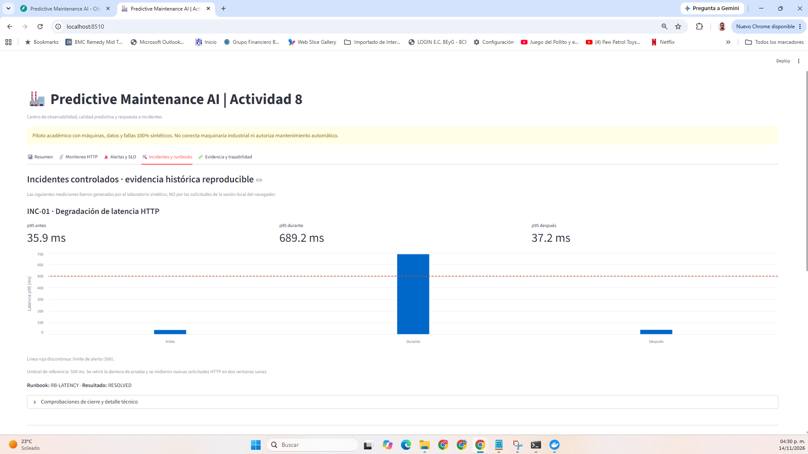
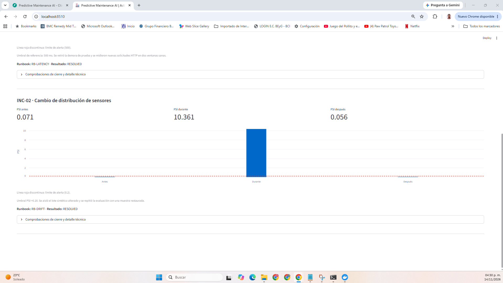

# Evidencias visuales — Actividad 8

> **Origen:** capturas de la ejecución local en Windows, aportadas el 14/11/2026. El sistema, los datos de máquinas y las fallas son **sintéticos**. Las capturas representan el dashboard del laboratorio y no demuestran un servicio cloud 24/7.

## Incidente INC-01 — Latencia HTTP

La captura presenta correctamente la secuencia **Antes → Durante → Después**, con línea discontinua de SLO en **500 ms**. Las cifras precisas y las verificaciones del runbook `RB-LATENCY` se encuentran en [`incidents.json`](../evidence/incidents.json).

## Incidente INC-02 — Data drift

La gráfica muestra el cambio de distribución inducido y la vuelta a una muestra restaurada, con umbral PSI **0.20**. El runbook documentado es `RB-DRIFT` y su estado se verifica en [`incidents.json`](../evidence/incidents.json).

## Trazabilidad y límites

- Las imágenes son capturas auténticas del dashboard de Streamlit después de la corrección de los ejes. No son visualizaciones reconstruidas para aparentar resultados.
- Los valores son los de la ejecución original del laboratorio registrada en el repositorio; las ejecuciones repetidas pueden variar mínimamente según entorno.
- El código fuente está en [`dashboard.py`](../dashboard.py), el generador de incidentes en [`laboratory.py`](../laboratory.py) y la verificación automática en [`verify.py`](../verify.py).
- Los dos incidentes fueron controlados y sintéticos; el runbook no ejecuta mantenimiento industrial.

## Archivos y huellas de integridad

| Imagen | SHA-256 |
|---|---|
| `INC-01_latencia_antes_durante_despues.png` | `a07f956225868d15143ab0228a66bda17baf623f51188bc2d18f12fb6693c9c5` |
| `INC-02_drift_antes_durante_despues.png` | `c55b5f897356485aeaf0cccbbd9b838f98de2df37b05f3d12d0dcca8c03a2314` |

## Evidencia adicional generada automáticamente

El [workflow de capturas visuales](../../.github/workflows/actividad8-mlflow-screenshots.yml) abre con Chromium la **interfaz MLflow 3.6** y el **dashboard Streamlit real**, tras ejecutar entrenamiento y dos incidentes sintéticos. Solo publica imágenes si puede leer las páginas y verificar su contenido. No son recreaciones gráficas.

| Tipo | Archivo | Demostración |
|---|---|---|
| MLflow | [MLflow_experimento_runs.png](../evidence/screenshots/MLflow_experimento_runs.png) | 1 entrenamiento y 6 runs de incidentes |
| MLflow | [MLflow_modelo_v2_metricas.png](../evidence/screenshots/MLflow_modelo_v2_metricas.png) | 15 métricas de modelo y parámetros |
| MLflow | [MLflow_incidente_latencia.png](../evidence/screenshots/MLflow_incidente_latencia.png) | Run degradado de latencia con SLO, tags y mediciones |
| MLflow | [MLflow_incidente_drift.png](../evidence/screenshots/MLflow_incidente_drift.png) | Run degradado con PSI de temperatura |
| Streamlit | [Dashboard_resumen.png](../evidence/screenshots/Dashboard_resumen.png) | Calidad offline y API local conectada |
| Streamlit | [Dashboard_monitoreo_http.png](../evidence/screenshots/Dashboard_monitoreo_http.png) | Duraciones reales de requests y consumo de presupuesto |
| Streamlit | [Dashboard_alertas_slo.png](../evidence/screenshots/Dashboard_alertas_slo.png) | Seis reglas, deduplicación y resoluciones |
| Streamlit | [Dashboard_incidentes_runbooks.png](../evidence/screenshots/Dashboard_incidentes_runbooks.png) | Antes/durante/después y runbooks |
| Streamlit | [Dashboard_trazabilidad.png](../evidence/screenshots/Dashboard_trazabilidad.png) | Registros y enlaces de entrega |

**Interpretación:** el dashboard generado en CI muestra solicitudes del laboratorio, incluyendo fallos deliberadamente inyectados. No confundir su p95 agregado con el estado normal de la API ni con la demostración local en Windows. Las dos capturas manuales de incidentes de esta página se conservan sin modificación.
