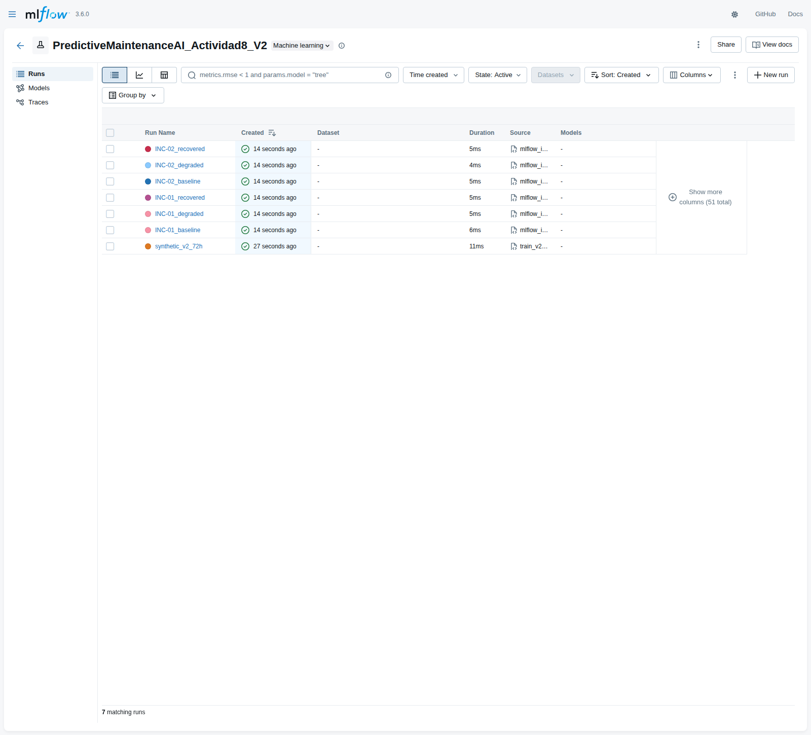
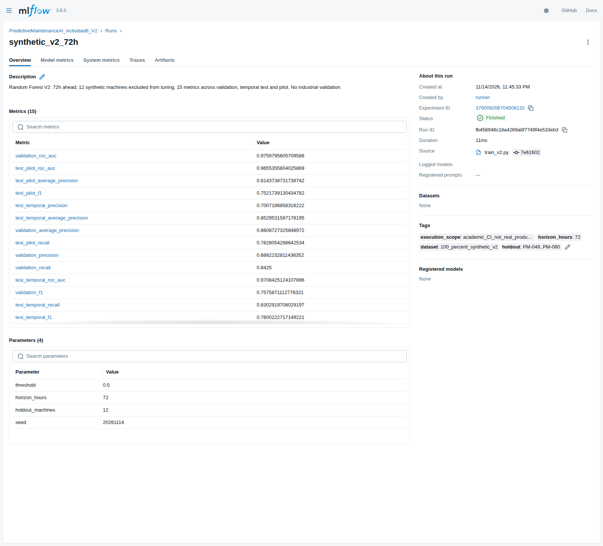
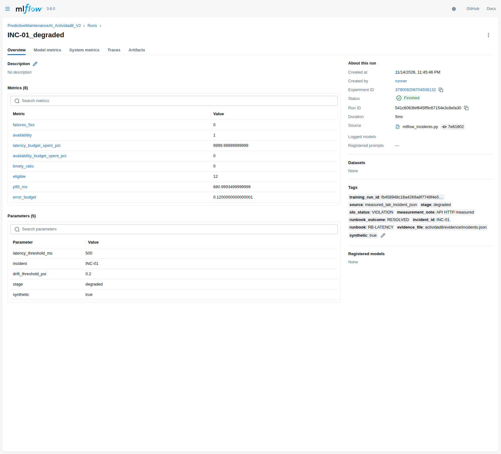
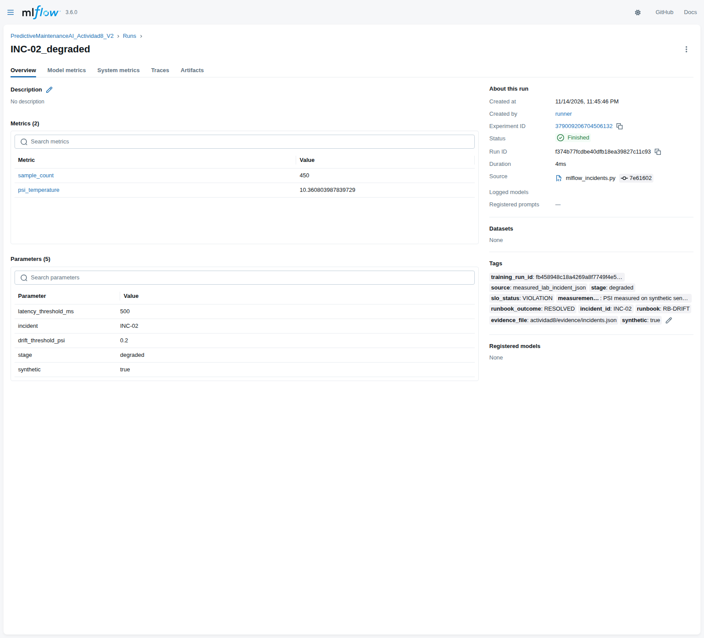

# Evidencia de MLflow — Actividad 8

## Registro verificado de un experimento real

El seguimiento de la versión V2 se ejecutó con **MLflow 3.6.0**, almacenado en el tracking store de archivos del ejecutor de GitHub Actions. **No es un dashboard MLflow alojado permanentemente ni un experimento de maquinaria real.** El programa que genera el experimento es [`train_v2.py`](../train_v2.py).

Se examinó el archivo ZIP de evidencia de la ejecución:
- [GitHub Actions #43649432772 (SUCCESS)](https://github.com/isaaccg88/PredictiveMaintenance-AI-FaseII/actions/runs/43649432772)
- [Artefacto descargable de esa ejecución](https://github.com/isaaccg88/PredictiveMaintenance-AI-FaseII/actions/runs/43649432772/artifacts/14135087201) — `actividad8-v2-evidencia-verificada` (retención configurada de 30 días).
- Experimento: `PredictiveMaintenanceAI_Actividad8_V2`
- Run ID de dicha ejecución: `3754bd814a32488ab7c8dd9bbb407d39`
- Run name: `synthetic_v2_72h`
- Estado del registro: `FINISHED` (ver `mlruns/.../meta.yaml` en el artefacto).

### Exportación de las métricas leídas del tracking store

| Métrica | Validación | Prueba temporal | Piloto (12 máquinas excluidas) |
|---|---:|---:|---:|
| Precision | 0.688223 | 0.700719 | 0.723849 |
| Recall | 0.842500 | 0.830292 | 0.782805 |
| F1 | 0.757587 | 0.760022 | 0.752174 |
| ROC-AUC | 0.975980 | 0.970843 | 0.965536 |
| Average Precision | 0.860873 | 0.852953 | 0.814374 |

Los **15 valores** de esta tabla se leyeron de los ficheros `mlruns/<experiment>/<run>/metrics/` de la ejecución indicada. Coinciden con los de [`evaluation_v2.json`](../results/evaluation_v2.json), donde se documentan el número de muestras, la matriz de confusión, la selección de umbral y la metodología.

### Parámetros y artefactos MLflow inspeccionados

| Parámetro | Valor registrado |
|---|---|
| `seed` | `20261114` |
| `horizon_hours` | `72` |
| `holdout_machines` | `12` |
| `threshold` | `0.5` |

En el directorio del run se incluyen los artefactos `evaluation_v2.json`, `metadata_v2.json` y `model_v2.joblib`. También se publica `results/mlflow_run.json` con el identificador de la corrida en el artefacto de Actions.

### Validación automática añadida

El programa [`mlflow_audit.py`](../mlflow_audit.py) consulta realmente el tracking store mediante `MlflowClient` y comprueba:
1. Que exista la corrida terminada y pertenezca al experimento esperado.
2. Que coincidan los cuatro parámetros registrados.
3. Que las 15 métricas registradas sean iguales a las del reporte de esa misma ejecución.
4. Que existan los tres artefactos MLflow de evaluación, metadata y modelo.

La verificación produce `evidence/mlflow_validation.json` y `evidence/mlflow_validation.md`, incluidos en el artefacto de CI. El workflow falla ante cualquier discrepancia. El validador de seguimiento fue ejecutado correctamente en GitHub Actions. Las corridas posteriores deben seguir verificándose por su estado real, sin presuponer éxito.

## Escenarios de incidentes registrados en MLflow

Se añadieron seis runs reales de seguimiento, tomando sus métricas de las ventanas HTTP y PSI medidas por el laboratorio. Los nombres son **INC-01_baseline**, **INC-01_degraded**, **INC-01_recovered**, **INC-02_baseline**, **INC-02_degraded** e **INC-02_recovered**. Se comprueba automáticamente su coherencia contra `incidents.json` mediante [el auditor de incidentes](../mlflow_incident_audit.py).

**Siete runs en un mismo experimento:** uno de entrenamiento y seis etapas de incidentes, sin presentar fases sintéticas como reentrenamientos o reparaciones industriales.

### Capturas auténticas y permanentes

Las capturas provienen de Chromium sobre la interfaz real MLflow 3.6.0, no de imágenes ficticias ni de otro proyecto:

**Figura A.** Experimento con el entrenamiento y los seis runs de incidentes.

**Figura B.** Métricas registradas para validación, prueba temporal y piloto.

**Figura C.** Condición de latencia incumplida, parámetros y tags del incidente medido.

**Figura D.** PSI de temperatura 10.3608 en un lote sintético de 450 lecturas; run etiquetado como degradado y asociado a RB-DRIFT. Las mediciones de recuperación están en [incidents.json](../evidence/incidents.json).

El [workflow de captura](../../.github/workflows/actividad8-mlflow-screenshots.yml) inicia el servidor MLflow, abre sus páginas con Chromium y publica únicamente capturas verificadas. El artefacto de GitHub Actions conserva el tracking store completo para su reproducción. Las capturas persistentes no caducan al finalizar la retención del artefacto de CI.

### Cómo comprobarlo sin instalar MLflow localmente

Abrir la ejecución de GitHub Actions, seleccionar el artefacto `actividad8-v2-evidencia-verificada` y descargarlo. Dentro del ZIP, inspeccionar `results/mlflow_run.json` y el árbol `mlruns/` con `params/`, `metrics/` y `artifacts/`. Para ver su interfaz en un equipo local, se puede abrir ese directorio con una instalación compatible de MLflow; **no es requisito para verificar las métricas de la exportación**.

### Alcance y límites

- Los datos, sensores, fallas y ventanas de pronóstico son **sintéticos**.
- La V2 se genera mediante un mecanismo diferente al de Fase II; no atribuir su mejora aparente exclusivamente al algoritmo.
- La corrida MLflow es efímera y sus registros brutos dependen de la retención del artefacto. Esta exportación textual conserva los valores verificados para la documentación académica.
- Las capturas de Streamlit documentan recuperación del servicio; las capturas de MLflow anteriores muestran auténticos runs del tracking store del laboratorio. No se confunden ambos instrumentos.
